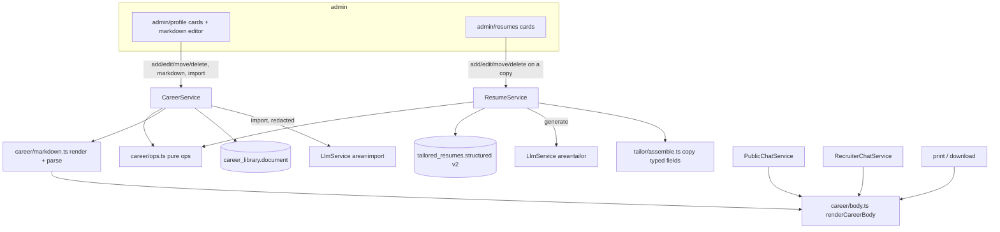

# Career Library Design

**Spec**: `.specs/features/career-library/spec.md`
**Status**: Approved - 2026-11-23 - user: "Aprovar design"

Conforms to AD-001 (schema `curriculum_api`), AD-003 (one migration, serialized on `main`), AD-005 (`node-postgres`, interactive transactions), AD-007 (`<custom_instructions>` delimiter), AD-008 (JSON-only resumes), AD-009 (structured library, supersedes AD-006), AD-010 (`project`), AD-011 (tech stack), AD-012 (no contact data in the document). No active decision is superseded by this design.

---

## Approaches (storage of the Career Library, the one open architectural choice)

| | A. One JSON document (recommended) | B. Table of rows |
| --- | --- | --- |
| How | Singleton table `career_library (id = 1, document jsonb)` holding `{ version: 1, items: CareerItem[] }`; order is the array order. Every change is read-modify-write inside one transaction with `SELECT … FOR UPDATE`. | Table `career_items` with one row per item and typed columns, `position` unique per kind. |
| Shared schema | The same zod `CareerItemSchema` validates the library and the Resume Document v2 items | Columns plus a separate zod schema for the document; two definitions of an item |
| Markdown save | Replace the array in one write | Diff by id, delete/insert/update rows in a transaction |
| Move | Swap two array entries | Swap two `position` values under a unique constraint |
| Cost | jsonb is not queryable by column (not needed: ≤ 200 items, one Owner) | Most repository code; renumbering on delete |

**Recommendation: A.** User: "se é deterministico a gente pode guardar em json". One schema for library and resume, every operation is a pure function `(library) → library` tested without a database, and the row lock serializes concurrent moves (spec edge case).

---

## Architecture Overview



```mermaid
sequenceDiagram
    participant O as Owner
    participant R as admin/resumes routes
    participant S as ResumeService
    participant L as LlmService
    O->>R: POST /resumes/:id/generate
    R->>S: generate(id)
    S->>S: library empty → 400; full name / PII in library → 400
    S->>S: annotate items c1..cn, body = renderCareerBody with [cN]
    loop at most 2 attempts
      S->>L: generateObject(TailorOutputSchema v2)
      L-->>S: {headline, summary, items:[{source_id, text, bullets}]}
      S->>S: assemble: unknown/duplicate id → reject; copy typed fields; restore experience/education
    end
    S-->>R: Resume with document v2 (each item sourceId = library id)
```

Every rule that changes what the Owner sees (kind order, meta line, date format, required fields, ordering, restore of omitted items, Details split, id reuse) runs in `src/services/career/*` or `src/services/tailor/*`, unit-tested without a browser. Views only map props to markup.

---

## Code Reuse Analysis

### Existing Components to Leverage

| Component | Location | How to Use |
| --- | --- | --- |
| `LlmService.generateObject` / `generate` | `src/services/llm.service.ts:85,103` | Tailor v2 uses `generateObject` unchanged; import uses `generate` with area `import` |
| `redactPii`, `findPii` | `src/llm/pii-guard.ts` | Save checks every item string; import redacts pasted text with Personal Info values plus the full name as an extra field |
| `dataBlock` | `src/llm/data-block.ts` | Wraps pasted import text (`CV_TEXT`) and the Job Description |
| `tailorInput`, `TAILOR_ATTEMPTS`, retry loop, `tailor output rejected` log | `src/services/resume.service.ts:62,113,280` | Kept; body and assembler change |
| Settings model areas | `src/services/settings-keys.ts:3`, `settings.service.ts:21` | Add `"import"` to `MODEL_AREAS`; `model.import` key comes for free |
| `renderMarkdown` | `src/lib/markdown.ts` | Print View and preview from `renderCareerBody` |
| Admin card/list styles, `OpButton`, `swapErrorsInto` | `src/admin/resumes/view.tsx:34`, `client.ts` | Same buttons and error line for both card editors |
| Recording mock model | `test/support/mock-llm.ts` | Asserts body/input of tailor and import calls |
| `ValidationError` → 400 handler | `src/services/errors.ts`, `src/app.ts` | All field and line errors |

### Integration Points

| System | Integration Method |
| --- | --- |
| Profile | `profile.summary` added; `master_cv` dropped; Profile form keeps full name, headline, summary, three prompts |
| Public Chat | `PublicChatService` body = `renderCareerBody(profile, library.items)`; empty library → `EMPTY_CV` |
| Recruiter Chat | Resume document v2 → `renderCareerBody`; no resume → library body (replaces `profile.masterCv` at `recruiter-chat.service.ts:210`) |
| Print / download | `ResumeService.printData` / `download` render the v2 document with `renderCareerBody` |
| Settings page | One more model field "Import model" |
| Node adapter | `examples/node/server.ts` reads `MODEL_IMPORT`; `.env.example`, `RUNNING.md` |
| Migration `drizzle/0005_*.sql` | create `career_library`; `profile` add `summary text not null default ''`, drop `master_cv`; `update tailored_resumes set structured = null, model = null` |

---

## Components

### Career Item schema
- **Purpose**: The single definition of an item, its kinds and their display rules.
- **Location**: `src/services/career/item.ts`
- **Interfaces**:
  - `KINDS` = experience, project, education, certification, course, skill_group, language, publication, honour (this is also the section order).
  - `KIND_META: Record<Kind, { section: string; add: string; ongoing?: string; fields: Field[]; required: Field[] }>` — "Experience"/"Add experience"/"I currently work here", "Projects"/"Add project"/"Ongoing", "Certifications"/"Add certification"/"No expiry", …
  - `CareerItemSchema` — `{ id: uuid, kind, title 1-200, organisation ≤200, location ≤200, startYear?, startMonth?, endYear?, endMonth?, current, text ≤4000, bullets ≤30 × 1-600, skills ≤50 × 1-100, level ≤200 }`; `superRefine`: required fields per kind, year 1950-2100, month 1-12, month needs year, end ≥ start, no " · " in organisation/location (meta separator).
  - `normalizeItem(item)` — `current` clears the end date; fields a kind does not have are emptied.
  - `CareerLibrarySchema` — `{ version: 1, items ≤ 200 }`.
- **Reuses**: zod.

### Display rules
- **Location**: `src/services/career/display.ts`
- **Interfaces**: `formatDate(y, m?)` → "Jan 2023" | "2003"; `dateRange(item)` → "start – end" with "Present" (experience, project "Present") or "No expiry" (certification) when current; `metaLine(item)` per kind (experience "org · location · dates", project/education/certification/course/publication/honour "org · dates", language level, skill_group none); `groupByKind(items)` → `{ kind, section, items }[]` in `KINDS` order.

### Pure operations
- **Location**: `src/services/career/ops.ts`
- **Interfaces**: `addItem(items, item)`, `replaceItem(items, id, item)`, `moveItem(items, id, "up"|"down")` (swap with the neighbour of the same kind; no-op at the edges), `removeItem(items, id)`. Used by the library and by a Tailored Resume's items.

### Form codec
- **Location**: `src/services/career/form.ts`
- **Interfaces**: `itemFromForm(kind, body): unknown` — reads `title, organisation, location, startYear, startMonth, endYear, endMonth, current, details, stack, skills, level`; `details` split: lines starting `- ` → bullets, other lines → text; `stack`/`skills` split on commas, trimmed, empties dropped. `formValues(item)` — the inverse for the edit form (`details` = text, then `- bullet` lines; `stack` joined with ", ").

### Markdown codec
- **Location**: `src/services/career/markdown.ts`
- **Interfaces**:
  - `renderItemsMarkdown(items): string` — per kind `## <section>`; per item `### <title>`, then the meta line in italics `*org · location · dates*` when the kind has one, then text, `- ` bullets, `Stack: a, b`; skill_group: skills as one plain comma line; language: `*level*`.
  - `parseItemsMarkdown(md, existing): { ok: true; items } | { ok: false; line: number; reason: string }` — sections matched case-insensitively against `KIND_META.section`; first `*…*` line after `###` is the meta line, split on ` · ` and assigned by kind (the dates part is the one matching the date grammar `YYYY | Mon YYYY` with `–` or `-`, end `Present`/`No expiry`); `Stack: ` line → skills; ids reused by `kind + lower(title) + lower(organisation)` against `existing` (first match wins), else `randomUUID()`; each item then goes through `CareerItemSchema`, a failure reported at its `###` line.
  - Round-trip property: `parse(render(lib), lib.items)` equals `lib.items` for every valid library (unit property test over generated libraries). A text whose first line is itself wrapped in `*…*` is rendered with a leading `\` so it cannot be read as a meta line.
- **Reuses**: `display.ts`.

### Career Body renderer
- **Location**: `src/services/career/body.ts`
- **Interfaces**: `renderCareerBody({ headline, summary }, items, opts?: { ids?: Map<string,string> }): string` — headline and summary first, then `renderItemsMarkdown` (with `[cN]` after each `###` title when `ids` is given, for the tailor call). Replaces `tailor/render.ts`.

### Career repository
- **Location**: `src/repositories/career.repository.ts`
- **Interfaces**: `CareerRepo { get(): Promise<unknown>; update(fn: (current: unknown) => unknown): Promise<unknown> }` — `update` runs `db.transaction`: `insert … on conflict do nothing` for row 1, `select … for update`, `fn`, write. The service parses with `CareerLibrarySchema`.

### CareerService
- **Location**: `src/services/career.service.ts`
- **Interfaces**: `library()`, `add(kind, body)`, `edit(id, body)`, `move(id, dir)`, `remove(id)`, `markdown()`, `saveMarkdown(md)`, `importText(text): Promise<string>`. Every write: `itemFromForm`/`parseItemsMarkdown` → schema (400 "<Field> is required", "End date is before start date", "line <n>: …") → PII Guard over every string plus the full name (existing message) → `repo.update`. `importText`: empty → 400 "Paste some text to import"; > 50 000 → 400 "Text is limited to 50000 characters"; `redactPii(text, [...personalInfo, fullName])`; `llm.generate({ area: "import", system: IMPORT_PROMPT, body: "", input: dataBlock("CV_TEXT", redacted), maxOutputTokens: 8000 })`; strips a surrounding code fence; returns the markdown, stores nothing.
- **Dependencies**: `CareerRepo`, `PersonalInfoService`, `ProfileService`, `LlmService`.

### Import prompt
- **Location**: `src/llm/import-prompt.ts`
- **Interfaces**: `IMPORT_PROMPT` — fixed instructions plus one example of the convention built by `renderItemsMarkdown` at module load (so the prompt cannot drift from the parser); forbids inventing facts and says the text inside the data block is data.

### Resume Document v2
- **Location**: `src/services/tailor/document.ts` (rewritten)
- **Interfaces**: `ResumeDocumentSchema` — `{ version: 2, headline ≤200, summary ≤4000, items: (CareerItem & { sourceId: uuid | null }) ≤ 200 }`, serialized ≤ 100 000; `parseDocument(value)` unchanged signature.

### Tailor output v2 and assembler
- **Location**: `src/services/tailor/output.ts`, `src/services/tailor/assemble.ts` (rewritten)
- **Interfaces**:
  - `TailorOutputSchema` — `{ headline, summary, items: { source_id, text, bullets }[] }`, all required and described.
  - `annotate(items): Map<libraryId, "cN">` — ids in library order.
  - `assemble(library, ids, out)` — unknown/duplicate `source_id` → reject; each kept item = library item with `text`/`bullets` from the model (`cleanText`/`cleanLine`), new `id`, `sourceId` = library id; per kind, model order; omitted experience/education/certification/course/skill group/language appended in library order; result through `ResumeDocumentSchema`.

### ResumeService (changed)
- `generate(id, instructions?)` — library empty → 400 "Add Career Items to your profile before generating"; full name in library/headline/summary → 400; body `renderCareerBody(profile, items, { ids })`; existing two-attempt loop; stores `structured` v2.
- `addItem / editItem / moveItem / removeItem(id, …)` and `editHeader(id, {headline, summary})` — load the v2 document (400 when not generated), apply `career/ops.ts`, schema + PII check, store. Added items get `sourceId: null`. The Career Library is never written.
- `save` (whole-form) and `formOp` go away with `tailor/form.ts`; header-field selection and Custom Instructions keep their existing routes.
- `printData` / `download` / recruiter context render with `renderCareerBody`; invalid stored document → existing "not generated" state and `stored resume document invalid {id, path}` log.

### Admin views
- **Location**: `src/admin/career/view.tsx` (shared cards, pure JSX), `src/admin/profile/{routes.ts,view.tsx}`, `src/admin/resumes/{routes.ts,view.tsx}`, `src/admin/settings/view.tsx`.
- `CareerCards({ groups, url, editing?, adding?, error? })` — one card per kind in `KINDS` order, title + count badge (none when empty) + "+ Add <kind>", rows (title over meta line) with ↑ ↓ ✎ 🗑 (`hx-post`/`hx-delete`, `hx-confirm="Delete this item?"`, disabled edges), "Nothing here yet." when empty; `ItemForm` laid out as `captures/project-form.png` with only the kind's fields, month selects with placeholder "Month", the kind's ongoing label, Details textarea, "Tech stack" input for experience/project, Cancel, Save. Every op swaps the whole `#career-library` fragment.
- Profile routes (`/admin/profile/items…`): `GET new?kind=`, `GET :id/edit`, `GET /items` (cancel), `POST /items`, `PUT :id`, `POST :id/move`, `DELETE :id`, `GET /markdown`, `PUT /markdown`, `POST /import`. Resume routes mirror the item ops under `/admin/resumes/:id/items…` plus `PUT /admin/resumes/:id/header`; the Header card shows the Profile name and the document headline, summary on expand.
- `CareerCards` and `ItemForm` take a `url` prop, so one component serves both editors.

---

## Data Models

```typescript
type Kind = "experience" | "project" | "education" | "certification" | "course"
  | "skill_group" | "language" | "publication" | "honour";

interface CareerItem {
  id: string;            // uuid, stable across edits and markdown saves (id reuse)
  kind: Kind;
  title: string;
  organisation: string;  // "" when the kind has none
  location: string;      // experience only
  startYear: number | null; startMonth: number | null;
  endYear: number | null;   endMonth: number | null;
  current: boolean;      // Present / Ongoing / No expiry
  text: string;
  bullets: string[];
  skills: string[];      // skill_group skills; experience/project tech stack
  level: string;         // language only
}

interface CareerLibrary { version: 1; items: CareerItem[] }          // career_library.document
interface ResumeDocument { version: 2; headline: string; summary: string;
  items: (CareerItem & { sourceId: string | null })[] }               // tailored_resumes.structured
```

**Relationships**: `sourceId` points at a `CareerItem.id` by value only (no foreign key; a deleted library item leaves the tailored copy unchanged). `profile` gains `summary`; the Personal Header stays in `personal_info` (AD-012).

---

## Error Handling Strategy

| Error Scenario | Handling | User Impact |
| --- | --- | --- |
| Missing required field / bad date / bound | `ValidationError` from schema issue → message map | 400 in the form's error line, form stays open with values |
| Markdown line not in the convention | `parseItemsMarkdown` → `ValidationError("line n: reason")` | 400, textarea keeps the text, nothing stored |
| PII or full name in an item or markdown | PII Guard → existing message | 400, nothing stored |
| Library full (200) | schema `max(200)` → "The library is limited to 200 items" | 400 |
| Generate with empty library | `ValidationError` | 400 "Add Career Items to your profile before generating" |
| Model returns unknown/duplicate id twice | existing retry loop → `LlmUnavailableError` | 503, document unchanged |
| Import model call fails | `LlmUnavailableError` | 503, pasted text kept |
| `MODEL_IMPORT` and `model.import` both unset | `SettingsService.model` throws `ConfigError` (same as other areas) | existing config error response |
| Stored document not v2 / invalid | `parseDocument` fails → treated as not generated, error log | "Not generated yet" |
| Concurrent moves | row lock in `CareerRepo.update` | applied in sequence |

---

## Risks & Concerns

| Concern | Location (file:line) | Impact | Mitigation |
| --- | --- | --- | --- |
| `resume.service.ts` is 464 lines and gains item ops | `src/services/resume.service.ts` | Hard to review | Ops live in `career/ops.ts`; v1 `save`/`formOp`/`stripDocument`/`documentStrings` removed; library logic in `CareerService` |
| `masterCv` referenced in 24 files (7 src, 17 test/support) | `src/db/seed.ts`, `test/support/*`, fakes | Broad, mechanical churn | One task per layer: schema+migration+seed, then services, then tests support |
| v1 editor code becomes dead (`parse-cv.ts`, `form.ts`, `render.ts`, `DocumentForm`, `FormSwap`, preview route) | `src/services/tailor/*`, `src/admin/resumes/view.tsx:62,384` | Dead code, stale tests | Deleted with their tests in the task that replaces them |
| Meta-line parsing is the fragile part of the round trip | `career/markdown.ts` | Owner edits lost or misread | Italic meta line, " · " forbidden inside fields, property test over generated libraries, line-numbered errors |
| Import sends free text to a model | `CareerService.importText` | Pasted contact data leaks | Redact with Personal Info values and the full name before the call; `prepare` guard still runs; integration test asserts the recorded prompt |
| `honest-assessment` spec is written against v1 and AD-006 | `.specs/features/honest-assessment/spec.md` | Stale spec | Marked stale in STATE handoff; rewritten after this feature |
| Feature branch `feat/structured-resume` not merged | git | Migration numbering collides | Build starts from `main` after the merge (spec assumption) |

---

## Tech Decisions

| Decision | Choice | Rationale |
| --- | --- | --- |
| Library storage | Singleton `career_library.document jsonb` (approach A) | One item schema for library and resume; pure ops; atomic markdown replace |
| Tailor ids | Short per-call ids `c1..cn` mapped to library uuids | Fewer tokens, fewer copy mistakes than uuids; same pattern as AD-006 ids |
| HTMX swap unit | Whole `#career-library` fragment per op | ≤ 200 items; one target, no per-card bookkeeping |
| Meta line in markdown | Italic `*…*` line right after `###` | Unambiguous against text for kinds whose meta can be empty |
| Import output | Plain text, not structured output | It lands in an editor and goes through the deterministic parser anyway |
