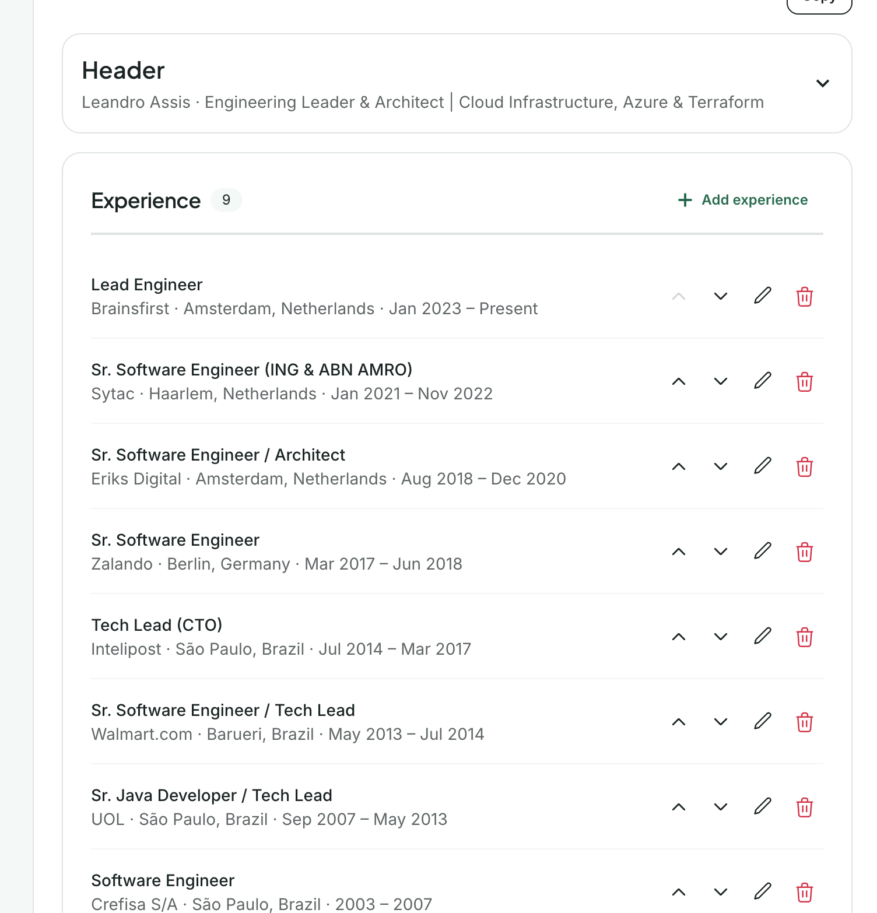
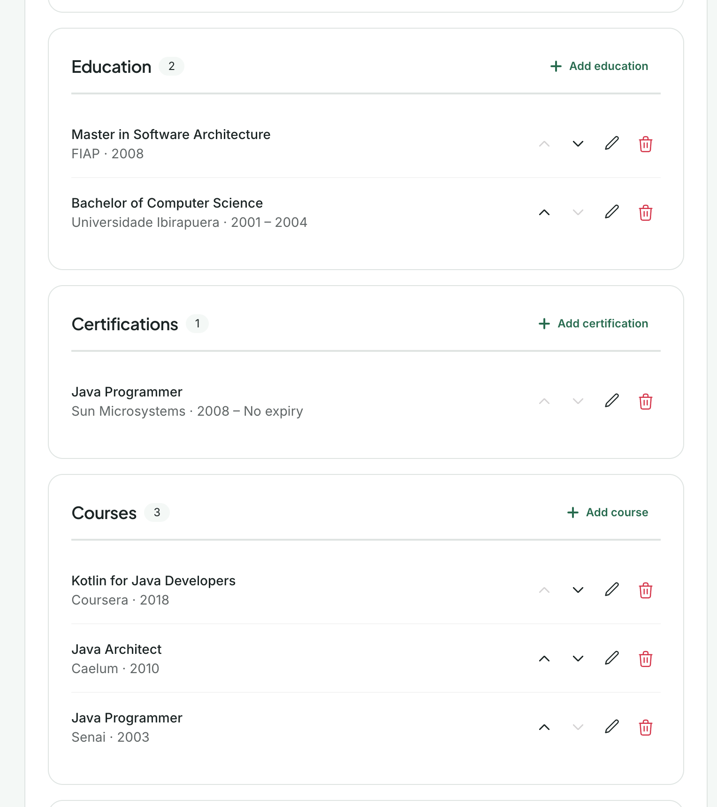
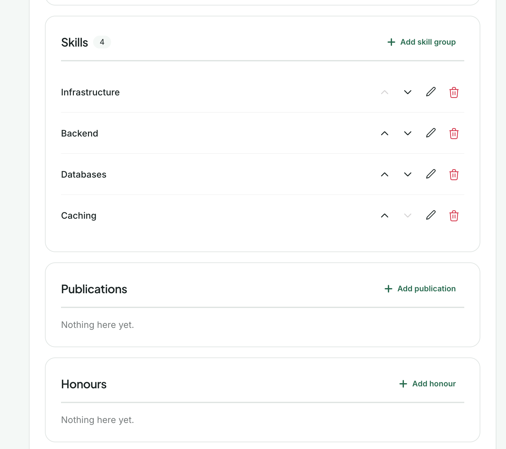
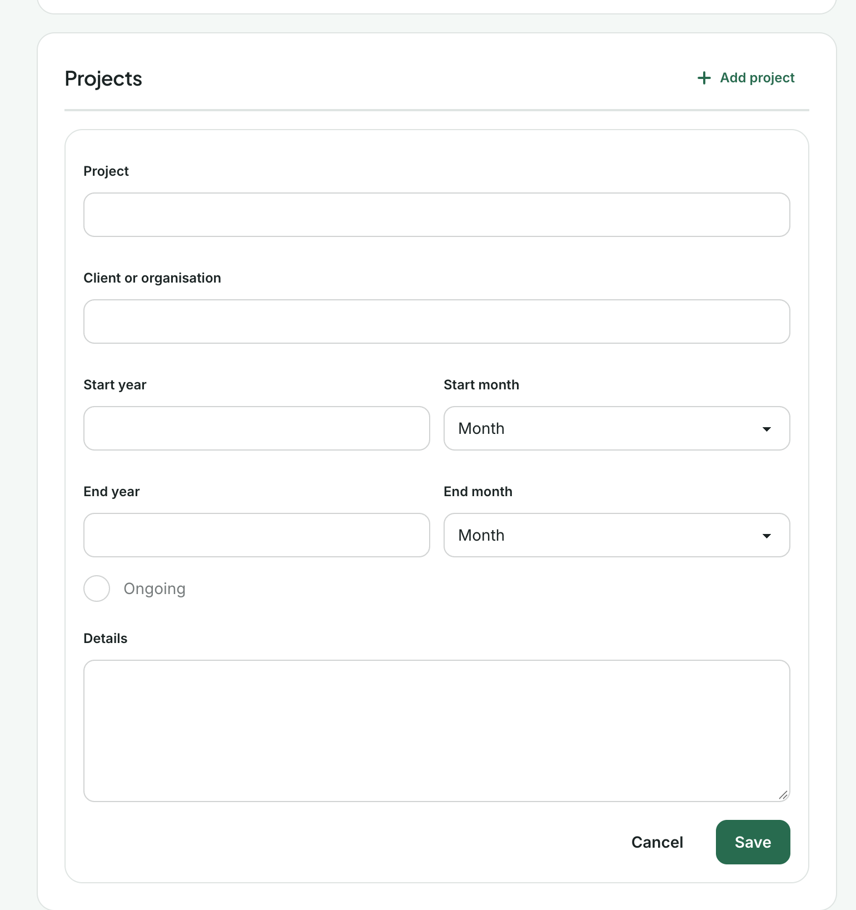

# Career Library Specification

**Approved**: 2026-11-23 - user: "Aprovar todos"

**Depends on**: `structured-resume` merged to `main` (AD-008). Supersedes AD-006 (Master CV parsed from markdown headings) with AD-009. Touches: `src/db/schema.ts` + one migration (serialized on `main`, AD-003), a new career-item repository and service, `src/services/tailor/*`, `src/services/resume.service.ts`, `src/services/public-chat.service.ts`, `src/services/recruiter-chat.service.ts`, `src/admin/profile/`, `src/admin/resumes/`, `GLOSSARY.md`. `honest-assessment` (spec not approved) is rewritten on top of this feature afterwards.

## Problem Statement

The Master CV is one free markdown text, so a role's title, employer, place and dates exist only inside a heading string. Tailored Resumes inherit that: dates cannot be formatted or checked, skills, certifications, courses and languages all fall into `other`, and nothing links a tailored item back to where it came from. The Owner wants the CV as typed Career Items edited in per-section cards, as the competitor captures show, with Tailored Resumes made from those items.

## Goals

- [ ] The Owner keeps the CV as Career Items of 9 kinds with typed fields, edited in one card per kind (count, Add, summary row, move up, move down, edit, delete).
- [ ] Every Tailored Resume item carries the `sourceId` of the Career Item it came from, and its title, organisation, location and dates are copied by code, never written by the model.
- [ ] The Career Body sent to an LLM is rendered by code from Career Items (Public Chat) or from a Resume Document (Recruiter Chat, print, download); no free-text Master CV remains.
- [ ] No Personal Info Field value and not the Owner's full name is stored in a Career Item or a Resume Document.

## Out of Scope

| Feature | Reason |
| --- | --- |
| Migrating the stored `master_cv` value | User: "nao estamos em producao entao os dados locais podem ser ignorados sem problema" - the library starts empty; the Owner pastes into the markdown editor |
| Converting v1 Resume Documents to v2 | Same answer; v1 documents are discarded |
| Owner-defined sections | Kinds are a fixed list in code |
| Owner reordering whole sections | Section order is fixed in code |
| Drag-and-drop reordering | Captures draw up/down buttons |
| Links and contact data inside the Resume Document | Personal Header stays in `personal_info`, encrypted, never sent to an LLM |
| JSON Resume export, new PDF templates | Later features this structure opens |
| Honest assessment (score, gaps, omissions) | Its own feature, rewritten after this one |

---

## Assumptions & Open Questions

| Assumption / decision | Chosen default | Rationale | Confirmed? |
| --- | --- | --- | --- |
| Master CV format | Structured Career Library replaces the markdown Master CV (AD-009) | User: "Biblioteca estruturada" | y |
| Existing local data | `profile.master_cv` dropped with no import; every stored v1 Resume Document set to NULL (row, inputs, recruiter links kept) | User: "nao estamos em producao entao os dados locais podem ser ignorados sem problema" | y |
| Editing surfaces | Career Items stored as data; two editors over the same data: cards (item by item) and markdown (whole library, deterministic parser, no LLM) | User: "se é deterministico a gente pode guardar em json e ter um edit item por item e outro tbm por markdown" | y |
| Markdown save and item identity | Saving the markdown replaces the library; a parsed item reuses the id of the existing item with the same kind, title and organisation, so `sourceId` links survive | Re-editing everything must not orphan Tailored Resume items | y - user: "Aprovar todos" |
| Import from arbitrary text via LLM | In this feature (P2): the model only turns pasted text into library markdown inside the editor; storage goes through the markdown parser | User: "Incluir agora" | y |
| Import result vs editor content | The import result replaces the markdown editor's content; the library changes only when the Owner saves | The Owner reviews before anything is stored | y - user: "Aprovar todos" |
| Import model and prompt | A new model area `import`: env `MODEL_IMPORT`, Settings Override key `model.import`, shown on the admin Settings page with the other models; default when unset follows the other `MODEL_*` defaults. The import prompt is fixed in code, not Owner-editable | User on default 10: "cria uma nova property para esse modelo" | y |
| Competitor captures | Binding for the Career Library page and the Tailored Resume editor | Captures came with the request ("queria uma estrutura parecida com essa"); not called inspiration | y - user: "Aprovar todos" |
| Item kinds | 9: experience, project, education, certification, course, skill_group, language, publication, honour | User: "temos q ter project" (AD-010) | y |
| Who changes what in a Tailored Resume | Model: picks items, orders items inside a section, rewrites `text`, `bullets`, `headline`, `summary`; never drops experience or education. Owner: edits every field of the tailored copy, the Career Item is untouched | Keeps facts code-owned at generation and leaves the Owner in control of the copy | y - user: "Aprovar todos" |
| Section order | Experience, Projects, Education, Certifications, Courses, Skills, Languages, Publications, Honours, in code | Captures show Experience first and Education→Certifications→Courses, Skills→Publications→Honours; the joins between groups are not visible | y - user: "Aprovar todos" |
| Edit gesture | The pencil swaps the row for the inline form of `project-form.png`; Add opens the same empty form at the end of the card | The capture draws the form inside the card; the row-swap matches the existing HTMX editor | y - user: "Aprovar todos" |
| Text and bullets in the form | One "Details" textarea per item, as the capture draws; lines starting "- " are bullets, other lines are text | Keeps the form as drawn while the model still tailors bullet by bullet | y - user: "Aprovar todos" |
| Delete confirmation | Browser confirm "Delete this item?" before delete | A delete is not reversible | y - user: "Aprovar todos" |
| Skills of a skill group | Stored as a list of strings, entered comma-separated, shown comma-separated | Competitor stores CSV in `bodyMarkdown`; a list validates and tailors per skill | y - user: "Aprovar todos" |
| Branch | Built on a branch cut from `main` after `structured-resume` is merged | Schema changes are serialized on `main` (AD-003) | y - user: "Aprovar todos" |
| Library bounds | ≤ 200 Career Items; per-field bounds in Edge Cases | Same order of magnitude as v1 document bounds | y - user: "Aprovar todos" |

**Open questions:** none - all resolved or logged above.

---

## User Stories

### P1: Career Library ⭐ MVP

**User Story**: As the Owner, I want my career as typed Career Items edited in per-kind cards so that dates, employers and skills are data, not text.

**Why P1**: Every other story reads from it.

**Acceptance Criteria**:

1. WHEN the Owner opens `/admin/profile` THEN the system SHALL show the Career Library cards in the order Experience, Projects, Education, Certifications, Courses, Skills, Languages, Publications, Honours, laid out as in `.specs/features/career-library/captures/header-experience.png`, `.specs/features/career-library/captures/education-certifications-courses.png` and `.specs/features/career-library/captures/skills-publications-honours.png`.
2. WHILE a kind has at least one Career Item the system SHALL show the item count badge next to the card title.
3. WHILE a kind has no Career Item the system SHALL show "Nothing here yet." in its card and no count badge, unless the form is open.
4. The system SHALL show each experience row as the title over "organisation · location · dates" and each project row as the title over "organisation · dates", omitting an empty part and its separator.
5. The system SHALL show each education, certification and course row as the title over "organisation · dates".
6. The system SHALL show each skill group row as the title only, each language row as the title over the level, and each publication and honour row as the title over "organisation · dates".
7. The system SHALL format a date as "Mon YYYY" when a month is set and "YYYY" otherwise, and a range as "start – end".
8. WHILE an experience is current the system SHALL show "Present" as its end; WHILE a certification is current the system SHALL show "No expiry" as its end.
9a. WHEN the Owner uses "Add project" or the pencil on a project row THEN the system SHALL show the form in `.specs/features/career-library/captures/project-form.png`: Project, Client or organisation, Start year, Start month, End year, End month (month selects with the placeholder "Month"), Ongoing, Details, Cancel and Save, plus a "Tech stack" input under Details (AD-011).
9b. The system SHALL show the forms of the other kinds in the same layout, with only the fields their kind has and the label "Ongoing" replaced by "I currently work here" for experience and "No expiry" for certification.
9d. WHEN the Owner saves a "Tech stack" input of an experience or project THEN the system SHALL store it split on commas, trimmed, empty entries dropped, as the item's `skills`, and show it joined with ", " when the form opens again.
9c. WHEN the Owner saves a Details field THEN the system SHALL store its lines starting with "- " as bullets and the other lines as text, and show the same split joined back as Details when the form opens again.
9. WHEN the Owner uses "+ Add <kind>" (Add experience, Add project, Add education, Add certification, Add course, Add skill group, Add language, Add publication, Add honour) THEN the system SHALL show an empty form for that kind at the end of its card.
10. WHEN the Owner saves a valid form THEN the system SHALL store the Career Item and re-render its card with the new row and the updated count.
11. WHEN the Owner uses the pencil on a row THEN the system SHALL replace the row with a form filled with that item's fields, with Save and Cancel.
12. WHEN the Owner uses Cancel THEN the system SHALL show the row unchanged.
13. WHEN the Owner uses the move-up or move-down button THEN the system SHALL swap the item with its neighbour in that kind, store the new order and re-render the card.
14. The system SHALL disable move-up on the first row and move-down on the last row of each card.
15. WHEN the Owner uses the trash button and confirms "Delete this item?" THEN the system SHALL delete the Career Item and re-render its card.
16. IF a required field of the kind is empty THEN the system SHALL answer 400 with "<Field> is required" and keep the form open with the entered values.
17. IF an end date is before its start date THEN the system SHALL answer 400 with "End date is before start date".
18. IF a Career Item field contains a Personal Info Field value or the Owner's full name THEN the system SHALL answer 400 with the existing PII Guard message and store nothing.
19. WHEN the Owner edits the Profile headline or summary THEN the system SHALL store them on the Profile.

**Independent Test**: Add an experience, a skill group and a certification, reorder two experiences, delete one; the cards, counts and meta lines match the captures.

---

### P1: Markdown editing ⭐ MVP

**User Story**: As the Owner, I want to edit the whole Career Library as markdown so that I can paste from another source and fix text faster than item by item.

**Why P1**: Entering a CV one item at a time is too slow; the library starts empty.

**Acceptance Criteria**:

1. WHEN the Owner uses "Edit as markdown" THEN the system SHALL show a textarea holding the Career Library rendered in the library markdown convention.
2. The system SHALL render each Career Item as `### <title>`, then a meta line "organisation · location · dates" (only the parts the kind has), then the text, then `- ` bullets, under `## <section>` in the fixed section order; a skill group's skills as one comma-separated line; an experience or project tech stack as a line "Stack: a, b" after its bullets; a language's level as its meta line.
3. WHEN the Owner saves the markdown THEN the system SHALL parse it without an LLM and replace the Career Library with the parsed items in the markdown's order.
4. The system SHALL parse the markdown rendered from any valid Career Library back into the same Career Library (same items, fields, order and ids).
5. WHEN a parsed item has the same kind, title and organisation as an existing Career Item THEN the system SHALL keep that Career Item's id.
6. IF a line does not fit the convention (unknown `##` section, date not recognised, item outside a section) THEN the system SHALL answer 400 with "line <n>: <reason>", keep the textarea with the entered text and store nothing.
7. IF a parsed item breaks a field rule of the Career Library THEN the system SHALL answer 400 with "line <n>: <field message>" and store nothing.
8. WHEN the Owner uses Cancel THEN the system SHALL show the cards unchanged.

**Independent Test**: Paste a markdown with 2 experiences and 1 skill group, save; the cards show them; open "Edit as markdown" again and save unchanged; ids and fields are identical.

---

### P2: Import from text

**User Story**: As the Owner, I want to paste CV text in any format and get it as library markdown so that I do not reformat it by hand.

**Why P2**: The markdown editor already makes entry fast; import removes the reformatting.

**Acceptance Criteria**:

1. WHEN the Owner uses "Import from text" THEN the system SHALL show a textarea for pasted text with Convert and Cancel.
2. WHEN the Owner uses Convert THEN the system SHALL replace every Personal Info Field value and the Owner's full name in the pasted text with `[redacted]` before any model call.
3. WHEN the Owner uses Convert THEN the system SHALL send the redacted text inside a data block with the fixed import prompt to the import model (`model.import` Settings Override, else `MODEL_IMPORT`) and put the model's markdown in the "Edit as markdown" textarea.
4. The system SHALL store nothing when Convert answers; the Career Library changes only through Save of the markdown editor.
5. IF the pasted text is empty THEN the system SHALL answer 400 with "Paste some text to import".
6. IF the pasted text exceeds 50 000 characters THEN the system SHALL answer 400 with "Text is limited to 50000 characters".
7. IF the model call fails THEN the system SHALL answer 503 with the existing model-unavailable message and keep the pasted text.
8. WHEN the Owner opens Settings THEN the system SHALL show an "Import model" field with the other model fields, and a saved value SHALL be used by the next Convert without a redeploy.

**Independent Test**: With the mock model returning a fixed markdown, Convert fills the editor with it, the library is unchanged, and the recorded prompt holds no Personal Info value or full name.

---

### P1: Career Body from the library ⭐ MVP

**User Story**: As the Owner, I want the chats and print to use my Career Items so that the free-text Master CV disappears.

**Why P1**: Without it the Public Chat has no CV after `master_cv` is dropped.

**Acceptance Criteria**:

1. The system SHALL render a Career Body as markdown from the Profile headline and summary and the Career Items, in the fixed section order, with `## <section>`, `### <title>`, a meta line, the text and `- ` bullets, and skills as one comma-separated line; an experience or project with a tech stack gets a line "Stack: a, b" after its bullets.
2. WHEN a Visitor asks a Question THEN the system SHALL send the Career Body rendered from the Career Library.
3. WHILE the Career Library is empty the system SHALL send the existing empty-CV body to the Public Chat.
4. The system SHALL never include a Personal Info Field value or the Owner's full name in a rendered Career Body.

**Independent Test**: With two Career Items, the Public Chat mock model records a body holding both titles and no `master_cv` text.

---

### P1: Tailored Resume v2 ⭐ MVP

**User Story**: As the Owner, I want a Tailored Resume made of copies of my Career Items so that the model can only choose and rewrite, not invent facts.

**Why P1**: The reason for the structure.

**Acceptance Criteria**:

1. The system SHALL store a Resume Document as `{ version: 2, headline, summary, items }`, each item holding `id`, `sourceId`, `kind`, `title`, `organisation`, `location`, `startYear`, `startMonth`, `endYear`, `endMonth`, `current`, `text`, `bullets`, `skills`, `level`.
2. WHEN the Owner uses Generate THEN the system SHALL send the model the Career Items rendered with an id per item and the Job Description, and nothing from the Personal Header.
3. WHEN the model answers THEN the system SHALL build each item by copying `kind`, `title`, `organisation`, `location`, dates, `current`, `skills` and `level` from the Career Item named by its id, and take `text` and `bullets` from the model.
4. The system SHALL set each item's `sourceId` to the id of the Career Item it was built from.
5. WHEN the model omits an experience or education Career Item THEN the system SHALL add it with its library text and bullets in library order after the model's items of that kind.
6. IF the model answers an unknown or duplicate id THEN the system SHALL reject that answer, retry once, and answer 503 with the existing message when the retry is also rejected.
7. IF the Career Library has no Career Item THEN the system SHALL answer 400 with "Add Career Items to your profile before generating".
8. WHEN the Owner opens a Tailored Resume THEN the system SHALL show a Header card (name and headline, summary on expand) and one card per kind with items, with the same rows and controls as the Career Library.
9. WHEN the Owner edits, moves, adds or deletes an item of a Tailored Resume THEN the system SHALL change only that resume's document and leave the Career Library unchanged.
10. WHEN the Owner adds an item to a Tailored Resume THEN the system SHALL store it with `sourceId` null.
11. The system SHALL render Print View, the markdown download and the Recruiter Chat context from the v2 document with the Career Body renderer.
12. IF a stored document is not a valid v2 document THEN the system SHALL treat it as not generated and log `stored resume document invalid {id, path}`.

**Independent Test**: Generate with the mock model returning two of three experiences reworded; the document holds three experiences with library titles and dates, two reworded, all with `sourceId`.

---

## Edge Cases

- IF a year is outside 1950-2100 or a month outside 1-12 THEN the system SHALL answer 400 with "<Field> is out of range".
- IF a month is set without its year THEN the system SHALL answer 400 with "<Field> needs a year".
- IF `current` is set and an end date is given THEN the system SHALL store the item with no end date.
- IF the Career Library already holds 200 Career Items THEN the system SHALL answer 400 with "The library is limited to 200 items".
- IF a title exceeds 200 characters, an organisation, location or level 200, a text 4000, a bullet 600, a skill 100, or an item has more than 30 bullets or 50 skills THEN the system SHALL answer 400 naming the field.
- WHEN the Owner moves the only item of a kind THEN the system SHALL keep it in place.
- IF two move requests for the same card arrive together THEN the system SHALL apply them in sequence inside one transaction each and keep positions unique per kind.
- IF a Career Item referenced by a `sourceId` is deleted THEN the system SHALL keep the tailored item unchanged.

Required fields per kind: experience - title, organisation, start year (tech stack optional); project - title, start year (client or organisation, end date, details and tech stack optional); education, certification, course - title, organisation; skill_group - title and at least one skill; language - title, level; publication, honour - title.

Dimensions: input validation - above; failure states - Generate retry (Tailored AC 6), invalid stored document (AC 12); idempotency - Save is a full replace of one item, retry-safe; auth - every route is behind admin auth, no new public route; concurrency - move edge case above; data lifecycle - deletes are hard deletes, `master_cv` and v1 documents dropped by migration; observability - existing generate logs plus the invalid-document log; external dependency - existing LLM error handling; state transitions - N/A because Career Items have no states.

---

## Requirement Traceability

| Requirement ID | Story | Phase | Status |
| --- | --- | --- | --- |
| CLIB-01 | P1 Library AC 1-8: cards, counts, empty state, meta lines, dates | Specify | Pending |
| CLIB-02 | P1 Library AC 9-12: add, edit, cancel | Specify | Pending |
| CLIB-03 | P1 Library AC 13-15: move, edges, delete | Specify | Pending |
| CLIB-04 | P1 Library AC 16-18 + edges: validation, bounds, PII | Specify | Pending |
| CLIB-05 | P1 Library AC 19: headline and summary | Specify | Pending |
| CLIB-11 | P1 Markdown AC 1-8: render, parse, round-trip, id reuse, line errors | Specify | Pending |
| CLIB-12 | P2 Import AC 1-8: redaction, import model, model to editor, nothing stored, bounds, failure | Specify | Pending |
| CLIB-06 | P1 Career Body AC 1-4 | Specify | Pending |
| CLIB-07 | P1 Tailored AC 1-7: v2 schema, generation, copy, restore, retry | Specify | Pending |
| CLIB-08 | P1 Tailored AC 8-10: editor cards, copy-only edits | Specify | Pending |
| CLIB-09 | P1 Tailored AC 11-12: outputs, invalid documents | Specify | Pending |
| CLIB-10 | Migration: `career_items`, profile `summary`, drop `master_cv`, null v1 documents | Specify | Pending |

**Coverage:** 10 total, 0 mapped to tasks.

---

## Differences from the source

| Source shows | Product shows | Confirmed |
| --- | --- | --- |
| Project form without a tech stack; no tech stack on experience | "Tech stack" input under Details on project and experience forms, stored as a list, rendered "Stack: …", copied by code when tailoring | y - AD-011 |
| Header card with name, headline, contact in the resume JSON | Header card reads name from Profile and contact from Personal Info; the document holds only headline and summary | y - AD-012 |
| Skills capture shows the Honours card in its window, right after Publications | Honours falls below the capture window: Languages sits between Skills and Publications by the confirmed section order | y - section order |
| Project-form capture shows Cancel and Save inside its window | Cancel and Save fall below the capture window: the approved Tech stack field makes the form taller | y - AD-011 |
| Header-experience capture shows a cut `Copy` button at the top right edge | No Copy button is built; Print and Download .md stay in the product toolbar | y - toolbar |

## Sources

- Competitor resume JSON pasted in the request - typed fields, kinds, `sourceItemId`, separate header.
-  - binding - Header card collapsed, Experience card with count, Add, rows title + "org · location · dates", up/down/edit/delete, disabled edges.
-  - binding - Education, Certifications ("No expiry"), Courses cards.
-  - binding - Skills rows (title only), empty Publications and Honours with "Nothing here yet.".
-  - binding - Projects card with the Add/Edit form open: Project, Client or organisation, Start/End year and month, Ongoing, Details, Cancel, Save.

---

## Success Criteria

- [ ] The Owner enters a full CV (9 experiences, 4 skill groups, 2 educations, 1 certification, 3 courses, 2 languages) and the cards match the captures.
- [ ] A generated Tailored Resume never shows a title, employer or date that differs from the Career Library unless the Owner edited it.
