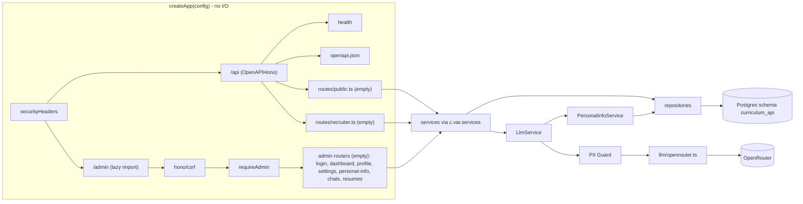
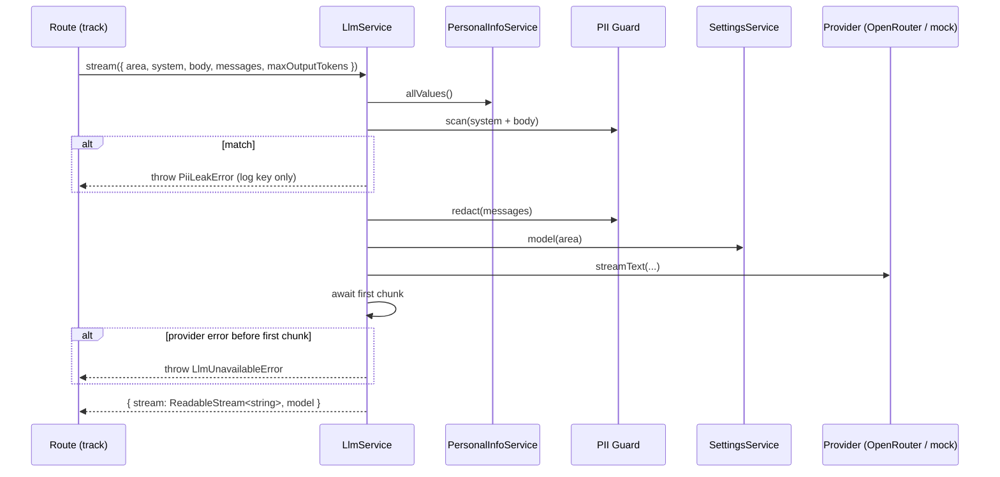

# Foundation Design

**Spec**: `.specs/features/foundation/spec.md`
**Status**: Draft

Conforms to AD-001 (schema `curriculum_api`), AD-002 (`neon-http` everywhere), AD-003 (foundation owns shared files) and AD-004 (DB login throttle). No confirmed lessons exist yet.

---

## Architecture Overview

**How tracks plug in without editing shared files.** Three approaches were considered; the first was chosen in Q2:

1. **Pre-wired skeleton (chosen).** Foundation creates every router file empty and every service/repository class with its final constructor signature, already mounted in `app.ts` and constructed in `container.ts`. Tracks only add methods and routes inside files they own. *Pro:* zero shared-file edits; plain explicit code. *Con:* empty files exist until tracks fill them.
2. **Plugin registry.** Each track exports a `register(app, container)` and `app.ts` loops over a list. *Con:* the list is still one shared file, and wiring becomes implicit.
3. **Accept merge conflicts.** Each track edits `app.ts` and `container.ts`. *Con:* 4 parallel branches conflict on the same lines.





---

## Code Reuse Analysis

The repository is empty (one `LICENSE`). Nothing in the codebase can be reused. Patterns come from `curriculum-specs/01-curriculum-api.md` §2.1, which this design follows.

### Integration Points

| System | Integration Method |
| ------ | ------------------ |
| Postgres (Neon / local) | `drizzle-orm/neon-http`; local via `local-neon-http-proxy` on `db.localtest.me:4444` |
| OpenRouter | `@openrouter/ai-sdk-provider` + `ai` `streamText` / `generateText`, only through `LlmService` |
| Cloudflare Turnstile | `fetch` POST to siteverify; `fetch` is injectable for tests |
| Consumers (tracks) | Empty routers + pre-constructed service classes (contract below) |

---

## Folder Structure (final, after foundation)

```
curriculum-api/
├── src/
│   ├── index.ts                       # export { createApp, migrate, seed }, types
│   ├── cli.ts                         # bin: migrate | seed | hash-password | cleanup
│   ├── config.ts                      # zod schema, resolveConfig(), ResolvedConfig
│   ├── app.ts                         # createApp() = buildApp(resolveConfig(c), createContainer(..))
│   ├── container.ts                   # composition root (all repos + services)
│   ├── env.ts                         # Hono Env type: Variables { services, session?, admin? }
│   ├── db/
│   │   ├── schema.ts                  # pgSchema("curriculum_api") + 7 tables
│   │   ├── client.ts                  # createDb(url) + local proxy routing
│   │   ├── migrate.ts                 # migrate(url)
│   │   ├── seed.ts                    # seed(url)
│   │   └── cleanup.ts                 # cleanup(url, days = 30)
│   ├── repositories/
│   │   ├── profile.repository.ts            # filled
│   │   ├── settings.repository.ts           # filled
│   │   ├── personal-info.repository.ts      # filled
│   │   ├── public-usage.repository.ts       # STUB → public-chat
│   │   ├── recruiter-chat.repository.ts     # STUB → recruiter-chat
│   │   ├── resume.repository.ts             # STUB → tailored-resumes
│   │   └── admin-login-attempt.repository.ts# STUB → admin-core
│   ├── services/
│   │   ├── errors.ts
│   │   ├── settings-keys.ts
│   │   ├── profile.service.ts          # filled
│   │   ├── settings.service.ts         # filled
│   │   ├── personal-info.service.ts    # filled
│   │   ├── llm.service.ts              # filled
│   │   ├── public-chat.service.ts      # STUB → public-chat
│   │   ├── recruiter-chat.service.ts   # STUB → recruiter-chat
│   │   └── resume.service.ts           # STUB → tailored-resumes
│   ├── llm/
│   │   ├── openrouter.ts               # createProvider(apiKey) → (modelId) => LanguageModel
│   │   ├── first-chunk.ts              # await first chunk, rethrow as LlmUnavailableError
│   │   ├── pii-guard.ts
│   │   └── default-prompts.ts
│   ├── security/
│   │   ├── session.ts                  # signSession / verifySession / cookie helpers
│   │   ├── crypto.ts                   # AES-256-GCM encrypt / decrypt
│   │   ├── turnstile.ts
│   │   ├── ip.ts
│   │   └── admin-auth.ts               # STUB → admin-core
│   ├── middleware/
│   │   ├── security-headers.ts
│   │   ├── require-session.ts
│   │   ├── require-admin.ts
│   │   └── require-active-recruiter-chat.ts  # STUB → recruiter-chat
│   ├── routes/
│   │   ├── health.ts                   # filled
│   │   ├── openapi.ts                  # filled
│   │   ├── public.ts                   # STUB router → public-chat
│   │   └── recruiter.ts                # STUB router → recruiter-chat
│   └── admin/
│       ├── index.tsx                   # admin router: csrf, requireAdmin, mounts, onError
│       ├── layout.tsx
│       ├── error-fragment.tsx
│       ├── static/htmx.generated.ts    # generated from htmx.org, committed
│       ├── login.tsx dashboard.tsx profile.tsx settings.tsx personal-info.tsx   # STUB → admin-core
│       ├── chats.tsx                   # STUB → recruiter-chat
│       └── resumes.tsx print.tsx       # STUB → tailored-resumes
├── drizzle/0000_init.sql + meta/       # the only migration (AD-003)
├── examples/node/server.ts
├── scripts/
│   ├── check-architecture.ts           # layering/portability/LLM-import rules, part of `pnpm lint`
│   └── vendor-htmx.ts                  # writes src/admin/static/htmx.generated.ts
├── test/
│   ├── support/{db.ts, global-setup.ts, mock-llm.ts, test-app.ts, config.ts, fakes/*.ts}
│   ├── unit/**/*.test.ts               # no DB
│   └── integration/**/*.test.ts        # Compose DB, serial
├── docker-compose.yml  drizzle.config.ts  biome.json  tsconfig.json  tsup.config.ts  vitest.config.ts
├── .github/workflows/ci.yml  .env.example  package.json
```

**Track ownership** (each track edits only its STUB files and adds tests under `test/unit/<track>/`, `test/integration/<track>/`):

| Track | Fills |
| ----- | ----- |
| `public-chat` | `routes/public.ts`, `services/public-chat.service.ts`, `repositories/public-usage.repository.ts` |
| `admin-core` | `admin/{login,dashboard,profile,settings,personal-info}.tsx`, `security/admin-auth.ts`, `repositories/admin-login-attempt.repository.ts` |
| `recruiter-chat` | `routes/recruiter.ts`, `admin/chats.tsx`, `services/recruiter-chat.service.ts`, `repositories/recruiter-chat.repository.ts`, `middleware/require-active-recruiter-chat.ts` |
| `tailored-resumes` | `admin/{resumes,print}.tsx`, `services/resume.service.ts`, `repositories/resume.repository.ts`, new `src/lib/markdown.ts` |

`/admin/profile/print` is owned by `tailored-resumes`: `admin/print.tsx` exports a router mounted at `/admin` that defines `/profile/print` and `/resumes/:id/print`. Hono matches the more specific path, so it does not clash with `admin/profile.tsx`.

---

## Components

### Config (`src/config.ts`)

- **Purpose**: Validate `CurriculumApiConfig` and apply defaults.
- **Interfaces**:
  - `resolveConfig(input: CurriculumApiConfig): ResolvedConfig`: throws `ConfigError(fields: string[])`
  - `type ResolvedConfig`: every optional field filled; `limits` fully populated
- **Rules**: `sessionSecret` is UTF-8 length ≥ 32 bytes; `piiEncryptionKey` is base64 decoding to 32 bytes. Zod issues are collected so one error lists every field.

### DB client (`src/db/client.ts`)

- **Interfaces**:
  - `createDb(url: string): Db`, where `type Db = PgDatabase<PgQueryResultHKT, typeof schema>` (generic, AD-002)
  - `fetchEndpointFor(host: string): string`: `db.localtest.me` → `http://db.localtest.me:4444/sql`, else `https://<host>/sql`
- **Notes**: Sets `neonConfig.fetchEndpoint = fetchEndpointFor` once at module load (a pure assignment, no I/O). Uses `drizzle(neon(url), { schema, casing: "snake_case" })`.

### Schema (`src/db/schema.ts`)

See Data Models.

### Migrate / seed / cleanup (`src/db/*.ts`)

- `migrate(url): Promise<void>` uses `drizzle-orm/neon-http/migrator` with `{ migrationsFolder, migrationsSchema: "curriculum_api", migrationsTable: "__drizzle_migrations" }`. The migrations folder resolves from `import.meta.url` to `../drizzle` (from `dist/`), falling back to `../../drizzle` (from `src/db/` under tsx/vitest).
- `seed(url): Promise<"created" | "exists">`: `INSERT … ON CONFLICT (id) DO NOTHING RETURNING id`.
- `cleanup(url, days = 30): Promise<{ publicUsage: number; loginAttempts: number }>`

### Domain errors (`src/services/errors.ts`)

```ts
abstract class DomainError extends Error { abstract readonly code: string; abstract readonly status: number }
ValidationError(400, "validation_error", fields?: Record<string,string>)
UnauthorizedError(401, "unauthorized")   ForbiddenError(403, "forbidden")
CaptchaFailedError(403, "captcha_failed") NotFoundError(404, "not_found")
ChatRevokedError(410, "chat_revoked")     ChatExpiredError(410, "chat_expired")
LimitReachedError(429, "limit_reached")   LlmUnavailableError(502, "llm_unavailable")
PiiLeakError(500, "internal_error", fieldKey)   // message never includes the value
ConfigError(500, "config_error", fields: string[])
DecryptionError(500, "internal_error")
```

`status` lives on the error, so the API and admin error handlers read the same mapping (§2.1 rule 5).

### Security primitives (`src/security/*`, `src/middleware/require-session.ts`)

- `signSession(payload: { scope: "public" | "recruiter" | "admin"; cid?: string }, secret: string, ttlSeconds: number): Promise<string>`
- `verifySession(token: string, secret: string): Promise<SessionPayload | null>`
- `setSessionCookie(c, token, cfg)`, `setAdminCookie(c, token, cfg)`, `clearAdminCookie(c, cfg)`
- `requireSession(scope: "public" | "recruiter"): MiddlewareHandler<Env>`: reads `curr_session`, sets `c.var.session`
- `clientIp(headers: Headers): string | null`; `hashIp(ip: string, salt: string): Promise<string>`
- `verifyTurnstile(token: string, ip: string | null, secret: string, fetchFn = fetch): Promise<boolean>` (fails closed)
- `encrypt(plain: string, keyB64: string): Promise<string>` → base64(`iv(12) ‖ ciphertext+tag`); `decrypt(...)` throws `DecryptionError`

### Shared repositories

All repositories take `db: Db` in the constructor, contain only queries, and export an interface the services depend on (fakes in `test/support/fakes/` implement it).

- `ProfileRepository`: `find(): Promise<ProfileRow | null>`; `upsert(input: ProfileInput): Promise<ProfileRow>`
- `SettingsRepository`: `get(key): Promise<string | null>`; `all(): Promise<Record<string,string>>`; `set(key, value)`; `delete(key)`
- `PersonalInfoRepository`: `list(): Promise<PersonalInfoRow[]>` (ordered `sort_order, key`); `find(key)`; `insert(row)`; `update(key, patch)`; `delete(key): Promise<boolean>`

### Shared services

- `ProfileService(repo)`: `get(): Promise<Profile>` (throws `NotFoundError`); `update(input: ProfileInput): Promise<Profile>`
- `SettingsService(repo, config)`: `model(area: "public" | "tailor" | "recruiter")`; `limit(name: LimitName)`; `pageSize(): "A4" | "Letter"`; `set(key, value)`; `overrides(): Promise<Record<string,string>>`. Allowed keys in `settings-keys.ts`: `model.public`, `model.tailor`, `model.recruiter`, `limits.<each §3 limit>`, `print.pageSize`.
- `PersonalInfoService(repo, keyB64)`: `list(): Promise<PersonalInfoMeta[]>` (no values); `create(input)`; `update(key, input)`; `delete(key)`; `reveal(key): Promise<string>`; `contactFor(channel: "public" | "recruiter" | "print"): Promise<ContactItem[]>`; `allValues(): Promise<{ key; label; value }[]>`

### PII Guard (`src/llm/pii-guard.ts`)

- `findPii(text: string, fields: PiiField[]): { key: string; label: string }[]`
- `redactPii(text: string, fields: PiiField[]): string`
- **Matching**: ignore values shorter than 3 characters. An email is compared trimmed and lowercased against lowercased text. A phone-like value (7 or more digits after stripping non-digits) matches when its digit string appears in the text's digit-only projection: each run of digits, spaces, `+`, `-`, `(`, `)` and `.` is collapsed to its digits. Any other value is a case-insensitive substring match.

### LLM gateway (`src/services/llm.service.ts`, `src/llm/openrouter.ts`, `src/llm/first-chunk.ts`)

- `type ModelFactory = (modelId: string) => LanguageModel`. `createProvider(apiKey)` in `openrouter.ts` returns it. Tests inject a factory that returns the recording mock.
- `LlmService(config, settings: SettingsService, personalInfo: PersonalInfoService, modelFactory: ModelFactory, logger = console)`
  - `stream(req: { area; system: string; body: string; messages: ChatMessage[]; maxOutputTokens: number }): Promise<{ stream: ReadableStream<string>; model: string }>`
  - `generate(req: { area; system: string; body: string; input: string; maxOutputTokens: number }): Promise<{ text: string; model: string }>`
  - The system prompt sent = `system + "\n\n<cv>\n" + body + "\n</cv>"`; the CV block stays last and stable, ready for prompt caching.
- `firstChunk(result)` reads `fullStream` until the first `text-delta` or `error`. On an `error`, or if the stream ends before any text, it throws `LlmUnavailableError`. Otherwise it returns a `ReadableStream<string>` that starts with the buffered chunk.

### Recording mock (`test/support/mock-llm.ts`)

- `createRecordingModel(opts: { chunks?: string[]; failBeforeFirstChunk?: boolean; text?: string })` → `{ factory: ModelFactory; calls: { modelId; prompt: string }[] }`. Built on the `ai/test` mock language model class that matches the installed `ai` major. `prompt` is the flattened system + messages text, so tests can assert `not.toContain(value)`.

### App (`src/app.ts`, `src/env.ts`, routes, middleware)

- `createApp(config): Hono` = `buildApp(resolveConfig(config), createContainer(resolved))`
- `buildApp(config: ResolvedConfig, services: Services): Hono`: used by tests with fake services
- Mount order: `securityHeaders` → `basePath` → `/api` (OpenAPIHono with `defaultHook` → `ValidationError`, `onError` → JSON) → `health`, `openapi`, `public`, `recruiter` → `/admin/*` lazy (`app.all("/admin/*", async c => (await loadAdmin()).fetch(...))`, where `loadAdmin` memoizes `import("./admin/index.js")`).
- **JSON error mapping**: a `DomainError` returns `{ error: code, message? }` with its status. Anything else is logged with its stack and returns 500 `{ error: "internal_error" }`.

### Admin shell (`src/admin/*`, `src/middleware/require-admin.ts`)

- `adminRouter(config)`: `csrf()` on non-GET; static route before `requireAdmin`; mounts the 7 stub routers plus `print`; `onError` renders `<ErrorFragment>` with the domain status.
- `requireAdmin`: verifies `curr_admin` with scope `admin`. On failure it returns a 303 to login, or a 401 with `HX-Redirect` when `HX-Request` is set. Login and static paths are exempt.
- `Layout({ title, children })`: nav (Dashboard, Profile, Settings, Personal info, Resumes, Chats), logout form posting to `/admin/logout`, `<script src="<base>/admin/static/htmx.min.js">`, inline CSS (allowed by `style-src 'unsafe-inline'`).

### Container contract for tracks (`src/container.ts`)

```ts
const repos = {
  profile: new ProfileRepository(db), settings: new SettingsRepository(db),
  personalInfo: new PersonalInfoRepository(db), publicUsage: new PublicUsageRepository(db),
  recruiterChats: new RecruiterChatRepository(db), resumes: new ResumeRepository(db),
  loginAttempts: new AdminLoginAttemptRepository(db),
};
const settings = new SettingsService(repos.settings, config);
const personalInfo = new PersonalInfoService(repos.personalInfo, config.piiEncryptionKey);
const profile = new ProfileService(repos.profile);
const llm = new LlmService(config, settings, personalInfo, createProvider(config.openrouterApiKey));
return {
  config, profile, settings, personalInfo, llm,
  publicChat: new PublicChatService(repos.publicUsage, profile, settings, llm),
  recruiterChat: new RecruiterChatService(repos.recruiterChats, profile, settings, personalInfo, llm),
  resumes: new ResumeService(repos.resumes, profile, settings, personalInfo, llm),
  adminAuth: new AdminAuthService(repos.loginAttempts, config),
};
```

Stubs declare these constructors with `private readonly` fields and no methods. A track that needs another dependency asks for a one-line container change on `main`, under the AD-003 rule.

---

## Data Models

Drizzle, `casing: "snake_case"`, all tables under `const curriculum = pgSchema("curriculum_api")`.

```ts
profile:               id integer PK default 1 CHECK (id = 1), fullName text NN, headline text NN, masterCv text NN,
                       publicSystemPrompt text NN, recruiterSystemPrompt text NN, tailorSystemPrompt text NN, updatedAt timestamptz NN default now()
settings:              key text PK, value text NN
personal_info:         key text PK, label text NN, sortOrder integer NN default 0, valueEncrypted text NN,
                       visibility text NN CHECK (visibility in ('public','recruiter','print')), updatedAt timestamptz NN default now()
tailored_resumes:      id uuid PK default gen_random_uuid(), title text NN, company text, jobDescription text NN,
                       content text NN default '', headerFields text[], model text, createdAt/updatedAt timestamptz NN default now()
recruiter_chats:       id uuid PK default gen_random_uuid(), token text NN UNIQUE, recruiterName text NN, company text,
                       jobDescriptionShort text, tailoredResumeId uuid FK → tailored_resumes.id ON DELETE SET NULL,
                       maxQuestions integer NN default 10, used integer NN default 0,
                       status text NN default 'active' CHECK (status in ('active','revoked')),
                       expiresAt timestamptz, createdAt timestamptz NN default now(), lastUsedAt timestamptz
public_usage:          ipHash text NN, day date NN, used integer NN default 0, PK (ipHash, day)
admin_login_attempts:  ipHash text NN, windowStart timestamptz NN, count integer NN default 0, PK (ipHash, windowStart)
```

`gen_random_uuid()` is built into Postgres 13+, so no extension is created in `public` (FND-05 AC 4). CHECK constraints use Drizzle's `check()` in the table's third argument.

---

## Error Handling Strategy

| Error Scenario | Handling | User Impact |
| -------------- | -------- | ----------- |
| Invalid config | `ConfigError` thrown synchronously by `createApp` | Deploy fails fast with every bad field named |
| DB unreachable | Driver error bubbles up as a non-domain error | `/api/*` 500 `internal_error`; `/api/health` unaffected |
| Domain error in `/api` | `onError` → `{ error, message? }` + status | Stable JSON contract |
| Domain error in `/admin` | admin `onError` → `<ErrorFragment>` + status | HTML fragment HTMX can swap |
| Provider fails before first token | `LlmUnavailableError` | Caller decides whether to decrement counters; 502 |
| PII in body or system prompt | `PiiLeakError`, warning log with field key | 500 `internal_error` |
| Turnstile unreachable | `verifyTurnstile` returns false | 403 `captcha_failed` |
| Tampered ciphertext / wrong key | `DecryptionError` | 500 in admin; never shows ciphertext |

---

## Risks & Concerns

| Concern | Location (file:line) | Impact | Mitigation |
| ------- | -------------------- | ------ | ---------- |
| `streamText` reports provider errors inside the stream, not as a throw, so the "decrement on failure before streaming" rule cannot be detected naively | `src/llm/first-chunk.ts` (new) | Counters would be consumed on outages | `firstChunk()` awaits the first `text-delta`/`error` before the route answers; unit-tested with a mock failing before its first chunk |
| AI SDK mock class name and option names (`maxOutputTokens`, `MockLanguageModelV2`/`V3`) differ by major version | `test/support/mock-llm.ts` (new) | Compile errors or wrong option name | T1 pins `ai` and records the major in `package.json` (installed: `ai` 7.0.179, major 7); the mock wraps the matching class in one file, so a bump touches only that file |
| `local-neon-http-proxy` is a third-party community image | `docker-compose.yml` (new) | Image disappears or lags Neon's protocol | Pinned by digest; CI uses the same Compose file; fallback documented in ADR 0002 (Neon dev branch) |
| Migrations folder path differs between `dist/` and `src/` | `src/db/migrate.ts` (new) | `migrate()` fails after packaging | Two candidate paths; the T8 integration test runs from source and a `pnpm build && node dist/cli.js migrate` CI step runs the packaged path |
| Integration tests share one schema | `test/support/db.ts` (new) | Flaky tests from shared state | Integration project runs with `fileParallelism: false`; `resetDb()` truncates all 7 tables before each test |
| Biome cannot express "directory A must not import directory B" for relative paths reliably | `scripts/check-architecture.ts` (new) | Layer rule unenforced | A custom script that resolves each import to a path and checks a rule table; runs inside `pnpm lint`; its own unit test uses fixtures |

---

## Tech Decisions (only non-obvious ones)

| Decision | Choice | Rationale |
| -------- | ------ | --------- |
| Layering lint | `scripts/check-architecture.ts` run by `pnpm lint` after `biome check` | Exact rule table, relative-path aware, testable |
| Test split | Vitest `projects`: `unit` (parallel, no DB) and `integration` (serial, Compose DB, global setup runs `migrate` once) | Fast unit loop; integration stays deterministic |
| HTMX serving | `pnpm vendor:htmx` writes `htmx.generated.ts` (`export default "<file>"`) from pinned `htmx.org`; committed | Bundles into `dist` with no file-system reads at runtime (Lambda/Cloudflare-safe) |
| `buildApp(config, services)` seam | Internal export used by route tests | Route tests with fakes, without a DB (§2.1 testing) |
| Lazy admin | `import("./admin/index.js")` memoized; tsup `splitting: true` | Chat routes do not load admin code on cold start (§5.3) |
| Repository interfaces | Each repository file exports `interface XRepo`; services depend on it | Fakes for service unit tests without mocking libraries |
