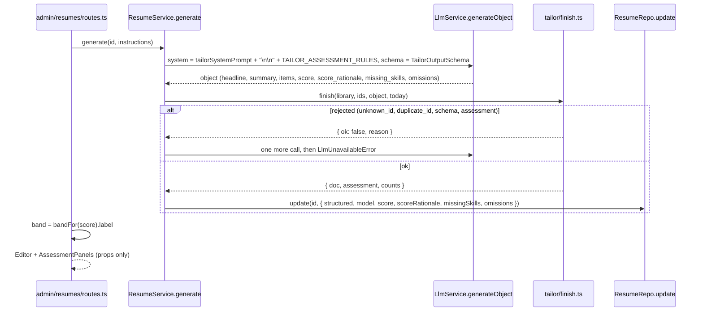

# Honest Assessment Design

**Spec**: `.specs/features/honest-assessment/spec.md`
**Status**: Approved - 2026-11-23 - user: "approve but do not implement yet"

Conforms to AD-003 (migration serialized on `main`), AD-007 (Custom Instructions tags), AD-009 (Career Library, Resume Document v2), AD-011 (tech stack is the item's `skills`). No AD is superseded.

---

## Architecture Overview

Approaches considered (same scope):

1. **Pure `finish` step after `assemble` (chosen).** One pure function turns the model output into `{ doc, assessment }`: assemble, collapse old roles, add notes, filter missing skills, check bounds. `ResumeService.generate` stays a thin loop: call, finish, store. Every rule is unit-testable without a DB or a model.
2. Rules inside `ResumeService.generate`. Fewer files, but every rule test goes through fakes and the retry loop.
3. Model-side only (prompt rules, no code step). Rejected by the spec (code enforces collapse, filter, notes).



`finish` order: `assemble` (now also returns the items it restored) → `collapseOldRoles(doc, todayYear)` → omissions = model omissions, restore notes, collapse notes → `filterMissingSkills(model list, library)` → `checkAssessment` on the model's assessment fields. A bound violation returns `{ ok: false, reason: "assessment" }`, which the existing loop treats as any rejection.

Every rule that changes what the Owner sees (filter, notes, collapse, band) runs in `src/services/tailor/` and is unit-tested. The view only renders props.

---

## Code Reuse Analysis

### Existing Components to Leverage

| Component | Location | How to Use |
| --------- | -------- | ---------- |
| `TailorOutputSchema`, `annotate` | `src/services/tailor/output.ts` | Extend with four assessment fields |
| `assemble`, `RESTORED_KINDS` | `src/services/tailor/assemble.ts` | Return the restored Career Items alongside the doc |
| `KIND_META[kind].section` | `src/services/career/item.ts` | `<Section>` in restore notes |
| `cleanLine` | `src/services/tailor/document.ts` | Trim model strings (missing skills, `what`, `reason`) |
| Retry loop, `tailorInput` (date first) | `src/services/resume.service.ts:242` | Unchanged loop; new `finish` call; system prompt concatenation |
| `ResumeRepo.update` | `src/repositories/resume.repository.ts:27` | Patch type grows with the new columns (inferred from schema) |
| `Editor`, `ResumeCards` | `src/admin/resumes/view.tsx:207,251` | Panels rendered after `ResumeCards` inside `#editor`, so the Generate swap refreshes them |
| Recording mock model | `test/support/mock-llm.ts` | Return assessment fields; capture system prompt |
| `sampleLibrary()`, `item()` | `test/support/career.ts` | Fixtures for filter, collapse, notes |
| Fakes for ResumeService | `test/support/resumes.ts`, `resume.fake.ts`, `career-service.ts` | Unit tests; the verify script reuses them with a real `LlmService` |
| `scripts/smoke-structured.ts` | `scripts/` | Pattern for the paid manual script (exit 2 without key) |

### Integration Points

| System | Integration Method |
| ------ | ------------------ |
| OpenRouter (tailor area) | Same `generateObject` call; larger schema, same `TAILOR_MAX_OUTPUT_TOKENS` 6000 |
| Postgres `curriculum_api.tailored_resumes` | Migration `0007`: four columns + CHECK |
| Admin editor | `GET /admin/resumes/:id` and `POST /admin/resumes/:id/generate` pass `assessment` + `band` props |

---

## Components

### Rubric and rules

- **Purpose**: Single source of the score bands and the code-owned prompt block.
- **Location**: `src/services/tailor/rubric.ts`
- **Interfaces**:
  - `SCORE_BANDS: readonly { min: number; label: string; meaning: string }[]` - ordered high to low
  - `bandFor(score: number): ScoreBand` - first band with `score >= min`
  - `rubricLines(): string[]` - `"<min>–<max> <label>: <meaning>"`, `max` = previous band's `min − 1`, top band 100
  - `TAILOR_ASSESSMENT_RULES: string` - heading, rubric lines, rules 1-7 (spec Prompt AC 3)
- **Dependencies**: none
- **Reuses**: none

### Output schema

- **Purpose**: The model contract with the assessment fields.
- **Location**: `src/services/tailor/output.ts` (modify)
- **Interfaces**:
  - `TailorOutputSchema` gains `score: z.number().int()`, `score_rationale: z.string()`, `missing_skills: z.array(z.string())`, `omissions: z.array(z.object({ what, reason }))`, each `.describe()`d; `score` says it rates the original Career Library, not the rewritten resume.
  - Bounds are not JSON Schema keywords (strict output ignores some): see `checkAssessment`.
- **Reuses**: existing schema style.

### Assessment rules

- **Purpose**: Pure code rules for the assessment.
- **Location**: `src/services/tailor/assessment.ts`
- **Interfaces**:
  - `type Omission = { what: string; reason: string }`
  - `type Assessment = { score: number; rationale: string; missingSkills: string[]; omissions: Omission[] }`
  - `ASSESSMENT_BOUNDS` - the spec's numbers
  - `checkAssessment(out: TailorOutput): boolean` - every bound, after trimming
  - `filterMissingSkills(skills: string[], library: CareerItem[]): string[]` - trim, drop empty, drop equal-ignoring-case to any library `skills` entry, dedupe keeping first
  - `restoreNote(item: CareerItem): Omission`
  - `collapseOldRoles(doc: ResumeDocument, todayYear: number): { doc: ResumeDocument; notes: Omission[] }`
- **Dependencies**: `KIND_META`, `ResumeDocument`
- **Reuses**: `cleanLine`

### Finish

- **Purpose**: Model output → stored document and assessment.
- **Location**: `src/services/tailor/finish.ts`
- **Interfaces**:
  - `finish(library, ids, out, today: Date): { ok: true; doc; assessment; restored: number; collapsed: number } | { ok: false; reason: AssembleFailure | "assessment" }`
- **Dependencies**: `assemble`, assessment rules
- **Reuses**: `assemble` (signature change: ok result adds `restored: CareerItem[]`)

### Storage

- **Location**: `src/db/schema.ts` (modify), `drizzle/0007_*.sql` (generated)
- Columns: `score integer` + CHECK `tailored_resumes_score` (`score between 0 and 100`), `score_rationale text not null default ''`, `missing_skills text[] not null default '{}'`, `omissions jsonb not null default '[]'`.

### ResumeService

- **Location**: `src/services/resume.service.ts` (modify)
- **Changes**:
  - `Resume` gains `assessment: Assessment | null` (null when `score` is null); `omissions` jsonb parsed with a zod schema, invalid → `[]`.
  - `generate` uses `system: \`${profile.tailorSystemPrompt}\n\n${TAILOR_ASSESSMENT_RULES}\``, `finish(...)` and one `update` with document, model and the four fields; logs `info("tailor assessment notes", { restored, collapsed })` when either is > 0.
  - `ResumeLogger` gains `info`.
  - Item edits, Add back, Save options never write the four fields (they never put them in a patch).

### Panels

- **Location**: `src/admin/resumes/view.tsx` (modify: `AssessmentPanels`), `src/admin/resumes/routes.ts` (modify: pass `assessment` and `band`)
- **Interfaces**: `AssessmentPanels({ assessment: AssessmentView | null })` where `AssessmentView = { score, band, rationale, missingSkills, omissions }`
- **Rules**: three panels after `ResumeCards`, inside `#editor`; single "Not assessed yet" panel when null; Hono JSX escapes text; badges use existing `badge` class, rows use existing list styles; `flex-col` stacking keeps 375 px without horizontal scroll.
- **Reuses**: design-system `card-pad`, `badge`, `muted`.

### Real-model check

- **Location**: `scripts/verify-tailor.ts`, `scripts/verify-tailor-checks.ts` (pure checks + fixtures), `package.json` script `verify:tailor` = `tsx --env-file=.env scripts/verify-tailor.ts`
- **Wiring**: `ResumeService` built with the in-memory fakes from `test/support/` and a real `LlmService` (`createProvider(OPENROUTER_API_KEY)`), so `generate` + `finish` run exactly as in production with no DB and no Personal Info Field.
- Prints one `PASS`/`FAIL` line per check; exit 1 on any fail, 2 without key.

---

## Data Models

```typescript
type Omission = { what: string; reason: string };          // stored jsonb array
interface Assessment {
  score: number;            // 0-100, DB CHECK
  rationale: string;        // 1-1000
  missingSkills: string[];  // ≤ 30 model items after filter, each 1-200
  omissions: Omission[];    // ≤ 30 model items (+ code notes), what 1-200, reason 1-300
}
```

**Relationships**: columns on `tailored_resumes`; deleted with the row.

---

## Error Handling Strategy

| Error Scenario | Handling | User Impact |
| -------------- | -------- | ----------- |
| Assessment bound broken | `finish` → `reason: "assessment"`, warn log, one retry | Second failure: existing "Generation failed, try again"; stored assessment unchanged |
| Score outside 0-100 reaches DB | Impossible after `checkAssessment`; DB CHECK as backstop | 500 if code regresses |
| Stored `omissions` jsonb malformed | Parsed to `[]` | Panel shows "Nothing was left out" |
| LLM unavailable | Existing `LlmUnavailableError` | Existing message; assessment unchanged |

---

## Risks & Concerns

| Concern | Location (file:line) | Impact | Mitigation |
| ------- | -------------------- | ------ | ---------- |
| Larger output may exceed 6000 tokens on a big library | `src/services/resume.service.ts:55` | Truncated JSON → schema rejection | Bounds cap assessment size (~30+30 short strings); real-model run reports token use; raise only if it fails |
| `assemble` signature change touches its tests | `src/services/tailor/assemble.ts:33` | Existing tests break | Additive field on the ok result; existing assertions keep working |
| Career-library working tree has uncommitted edits to `document.ts` | `src/services/tailor/document.ts` | Merge conflicts | Execute only after `career-library` merges to `main` (spec) |
| Default prompt already states keep-every-kind rules | `src/llm/default-prompts.ts:31-32` | Rules duplicated in system prompt | Accepted: the code block must hold for stored prompts that predate it |

---

## Tech Decisions

| Decision | Choice | Rationale |
| -------- | ------ | --------- |
| Bounds enforcement | Code (`checkAssessment`), not JSON Schema keywords | Strict structured output ignores or rejects some keywords (existing comment in `output.ts`) |
| Band label in the view | Route computes `bandFor(score).label`; view gets a string | Views may not import services (architecture check) |
| Collapse after restore | `collapseOldRoles` runs on the assembled doc | Spec Collapse AC 5: restored roles collapse too |
| Verify script wiring | Test fakes + real LLM, no DB | Script must not touch the Owner's library or need Neon |
