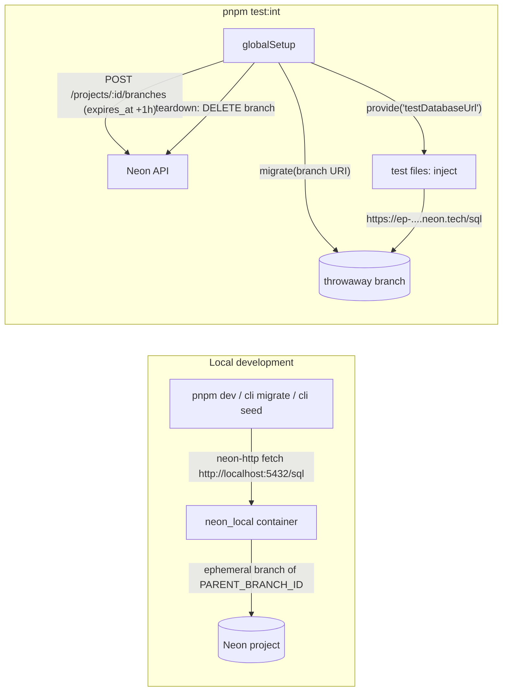

# Neon Dev and Test Databases Design

**Spec**: `.specs/features/neon-dev-test-db/spec.md`
**Status**: Draft

---

## Architecture Overview



## Facts from documentation

- Neon Local (`https://neon.com/docs/local/neon-local`, read 2026-11-22): serves the serverless driver over plain HTTP at `http://<host>:5432/sql`; credentials `neon:npg`; `DRIVER` is deprecated (both drivers served at once); `PARENT_BRANCH_ID` forks an ephemeral branch, `DELETE_BRANCH` defaults to `true`. No healthcheck is documented, so `docker compose up -d --wait` waits for the container to be running only.
- Create branch API (`/docs/reference/api/branches/create-project-branch`): body `{ branch: { name, parent_id, expires_at }, endpoints: [{ type: "read_write" }] }`; `expires_at` is RFC 3339 to the second. The page marks `expires_at` Early Access and does not document `connection_uris`; curriculum-ai's `scripts/gate-branch.ts` uses both against the same Neon account today, so this design relies on that working code.
- `neonConfig.fetchEndpoint` accepts `(host, port) => string` (`@neondatabase/serverless` `index.d.ts:618`).

## Components

### `src/db/client.ts` (modify)

`fetchEndpointFor(host, port)`: `localhost` and `127.0.0.1` -> `http://<host>:<port or 5432>/sql`; any other host -> `https://<host>/sql`. The `db.localtest.me` -> `:4444` rule is removed (DEV-02, DEV-03, DEV-04).

### `docker-compose.yml` (rewrite), `docker/initdb.sql` (delete)

One service `db`, image `neondatabase/neon_local:latest`, port `5432:5432`, env `NEON_API_KEY`, `NEON_PROJECT_ID`, `PARENT_BRANCH_ID`, `DELETE_BRANCH: ${DELETE_BRANCH:-true}`. Compose reads `.env` from the project dir by default (DEV-01, DEV-04).

### `test/support/neon-branch.ts` (new)

```ts
interface TestBranchDeps {
  env: Record<string, string | undefined>;
  fetch: typeof fetch;
  migrate: (url: string) => Promise<void>;
  log: (line: string) => void;
  now?: () => Date;
  sleep?: (ms: number) => Promise<void>;
}
export async function startTestBranch(deps): Promise<{ url: string; branchId: string; stop(): Promise<void> }>;
```

- Reads `NEON_API_KEY`, `NEON_PROJECT_ID`, `TEST_PARENT_BRANCH_ID ?? PARENT_BRANCH_ID`; missing -> throws `<NAME> is not set` before any fetch (TEST-06).
- `POST https://console.neon.tech/api/v2/projects/:id/branches` with name `test-<timestamp>`, `parent_id`, `expires_at = now + 1h` (TEST-01, TEST-02), `endpoints: [{type:"read_write"}]`.
- Waits for each returned operation to finish (`GET /operations/:id`, 1 s poll, 60 tries), then `migrate(connection_uris[0].connection_uri)` (TEST-03). Migration or wait failure -> delete branch, rethrow (TEST-11).
- Non-2xx -> throws `Neon API <METHOD> <path> returned <status>: <message>` (TEST-07). Messages and logs carry branch ids only, never the key or a URI (TEST-08).
- `stop()` deletes the branch; a failed delete logs `could not delete test branch <id>` and does not throw (TEST-05, TEST-10).

### `test/support/global-setup.ts` (modify)

`createGlobalSetup(deps)` returns the Vitest `globalSetup` function: loads `.env` with `process.loadEnvFile` when present (no override of set variables), calls `startTestBranch`, `provide("testDatabaseUrl", url)`, returns `stop` as teardown. Default export wires real `fetch`, `migrate`, `console.log`. Vitest runs the teardown whether tests pass or fail (TEST-05).

### `test/support/db.ts`, `test/support/config.ts` (modify)

`TEST_DATABASE_URL = inject("testDatabaseUrl")` in integration; `config.ts` falls back to a placeholder `postgres://unused@unused.invalid/unused` for unit tests that never query. Nothing in `test/` reads `process.env.DATABASE_URL` or `process.env.TEST_DATABASE_URL` (TEST-04).

### `src/cli.ts` (already modified in the working tree)

`migrate` prefers `DATABASE_URL_UNPOOLED` (MIG-01..03).

## Code reuse

- `scripts/gate-branch.ts` in curriculum-ai: Neon API call shape, operation polling, TTL, delete-in-finally. Ported, not imported (separate repo).
- `src/db/migrate.ts` unchanged; `globalSetup` already calls it.

## Risks & Concerns

| Concern | Mitigation |
| ------- | ---------- |
| `expires_at` is Early Access per Neon docs | Already accepted by this Neon account in curriculum-ai; if Neon rejects it, TEST-07 surfaces the 4xx with Neon's message |
| Integration runs now need network + Neon credentials | Unit project stays offline (TEST-09); missing variables fail fast (TEST-06) |
| Each run creates a compute: ~seconds of start-up per run | Accepted trade-off of answer 1a |
| Neon credentials today live in `.env.local`, which no script reads | RUNNING.md says to put them in `.env`; the Owner moves them |
| Unrelated working-tree change: `.specs/features/resume-custom-instructions/proofs.md` | Not part of this feature; left unstaged, the Owner decides |
| Neon Local database name | `neondb` (Neon's default database) in docs; the Owner uses the name of the database on their `dev` branch |
