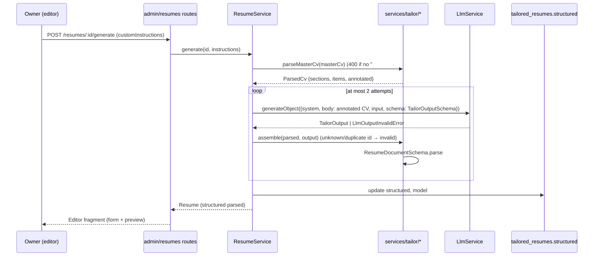

# Structured Resume Design

**Spec**: `.specs/features/structured-resume/spec.md`
**Status**: Approved - 2026-11-23 - user: "Approve, go to tasks"

Conforms to AD-001 (schema `curriculum_api`), AD-003 (one migration, serialized on `main`), AD-005 (`node-postgres`), AD-006 (Master CV parsed by headings), AD-007 (`<custom_instructions>` delimiter), AD-008 (JSON-only resumes). No active decision is superseded.

---

## Approaches (editor form, the one open architectural choice)

Generation, storage and outputs have one obvious shape (below). The editor's Remove / Move up / Move down can be built three ways; all deliver the same spec.

| | A. Server round-trip (recommended) | B. Client script | C. Hidden JSON field |
| --- | --- | --- | --- |
| How | Each button `hx-post`s the whole form to `POST /admin/resumes/:id/form` with `op=remove\|up\|down` and a target `s<i>.i<j>`; the server parses the form, applies the op, re-renders the form fragment. Nothing is saved until Save. | Buttons move or remove DOM nodes in a small compiled script; Save posts the form. | A script keeps the document as JSON in a hidden input and rebuilds the form. |
| Where the rule runs | Service/pure function, unit-tested | Browser, no test reaches it | Browser, no test reaches it |
| Cost | One request per click (local admin, cheap) | New client code + DOM indexing bugs | Most client code |

**Recommendation: A.** Remove and reorder change what the Owner sees, so they run in a layer the tests reach (skill rule 6), and it matches the existing HTMX pattern (preview already posts the form per keystroke).

---

## Architecture Overview



Outputs: `renderResumeMarkdown(doc)` → Print View (`renderMarkdown`), markdown download, recruiter Career Body.

---

## Code Reuse Analysis

### Existing Components to Leverage

| Component | Location | How to Use |
| --- | --- | --- |
| `LlmService.prepare` (PII guard on system + body, model resolution, `<cv>` block) | `src/services/llm.service.ts:85` | New `generateObject` reuses it unchanged |
| `redactPii`, `findPii` | `src/llm/pii-guard.ts` | Input redaction (LLM); Save checks every document string |
| `sanitizeMarkers`, `dataBlock` | `src/llm/data-block.ts` | Custom Instructions and Job Description in `tailorInput` |
| `renderMarkdown` | `src/lib/markdown.ts` | Print View body and preview from rendered markdown; inline markdown in strings |
| `ResumeService.checkInstructions`, `loadProfile`, `buildPrint` | `src/services/resume.service.ts` | Kept; `buildPrint` takes rendered markdown |
| Recording mock model | `test/support/mock-llm.ts` | Return JSON text; record `responseFormat` to assert the schema and `.describe()` texts |
| `swapErrorsInto("editor-status")` | `src/admin/resumes/client.ts` | 400s from Save/form ops land in the status line |
| `ValidationError` → 400 JSON/HTML handler | `src/services/errors.ts`, `src/app.ts` | Schema failures on Save |
| `zod` 4.6.7 | dependency | Both schemas; `z.toJSONSchema` is what the `ai` SDK sends |

### Integration Points

| System | Integration Method |
| --- | --- |
| `ai` 7 `generateText({ output: Output.object({ schema, name }) })` | Sends `responseFormat: {type:"json", schema}`; result `.output` is parsed and validated; failure throws `NoObjectGeneratedError` |
| OpenRouter provider | `provider(modelId, settings)` accepts `OpenRouterChatSettings` (`structuredOutputs.strict`, `provider.require_parameters`, `plugins`) |
| Recruiter chat | `RecruiterChatRepo.resumeContent` returns `structured` (jsonb); `RecruiterChatService` parses + renders; NULL/invalid → Master CV (existing fallback) |
| Print routes | `ResumeService.printData` / `download` render from the document; unchanged routes |
| Migration | `drizzle/0003_*.sql` via `pnpm db:generate`, hand-checked: add `structured jsonb`, drop `content`, `update … set model = null` |

---

## Components

### Resume Document schema
- **Purpose**: The single definition of a stored Tailored Resume.
- **Location**: `src/services/tailor/document.ts`
- **Interfaces**:
  - `ResumeDocumentSchema: z.ZodType` — `version: z.literal(1)`, `sections` ≤ 30, each `{ title ≤ 200, kind: z.enum(["intro","experience","education","other"]), text ≤ 4000, items ≤ 40 }`, item `{ heading 1-200, text ≤ 4000, bullets ≤ 30 × (1-600) }`; `superRefine` on serialized length ≤ 100 000.
  - `type ResumeDocument = z.infer<typeof ResumeDocumentSchema>`
  - `parseDocument(value: unknown): { ok: true; doc } | { ok: false; path: string }` — first failing path as `sections.2.items.0.heading`.
  - `stripPrefix(s: string): string` — removes a leading `#{1,6} `, `- ` or `* `.
- **Dependencies**: zod.
- **Reuses**: none.

### Master CV parser
- **Purpose**: Turn the Master CV markdown into sections/items with ids, kinds and an annotated CV for the model.
- **Location**: `src/services/tailor/parse-cv.ts`
- **Interfaces**:
  - `parseMasterCv(md: string): ParsedCv | null` — null when no line starts with `## `.
  - `ParsedCv = { sections: ParsedSection[]; annotated: string }`; `ParsedSection = { id: "s<n>", title, kind, text, items: { id: "i<n>", heading, text, bullets }[] }`.
  - `sectionKind(title: string): Kind` — NFD + strip accents + lowercase, matched against the AD-006 list.
  - `annotated`: the Master CV with each `## ` / `### ` line suffixed by ` [s3]` / ` [i7]` and intro preceded by `[s0]`; ids in source order (sections `s0…`, items `i1…`).
- **Dependencies**: none (pure).
- **Reuses**: same bullet/text split as the form parser below.

### Tailor output schema and assembler
- **Purpose**: The model-facing schema, and the code that builds a Resume Document from it with code-owned headings.
- **Location**: `src/services/tailor/output.ts`, `src/services/tailor/assemble.ts`
- **Interfaces**:
  - `TailorOutputSchema` — `{ sections: { source_id, text }[], items: { source_item_id, text, bullets: string[] }[] }`, every field required and `.describe()`d, no length bounds (strict-mode friendly; bounds run in `ResumeDocumentSchema` after assembly).
  - `assemble(parsed: ParsedCv, out: TailorOutput): { ok: true; doc } | { ok: false; reason: "unknown_id" | "duplicate_id" | "schema" }` — source order; titles/kinds/headings from `parsed`; `stripPrefix` on every string; drops sections with no text and no items; result parsed by `ResumeDocumentSchema`.
- **Dependencies**: document.ts, parse-cv.ts.
- **Reuses**: —

### Markdown renderer
- **Purpose**: One rendering of a Resume Document for print, download and recruiter context.
- **Location**: `src/services/tailor/render.ts`
- **Interfaces**: `renderResumeMarkdown(doc: ResumeDocument): string` — `## title` (none for `intro`), text, `### heading`, text, `- bullet`, blank line between blocks.
- **Dependencies**: document.ts.

### Form codec
- **Purpose**: Build a document from the editor form and apply Remove / Move ops.
- **Location**: `src/services/tailor/form.ts`
- **Interfaces**:
  - `documentFromForm(body: Record<string, unknown>): unknown` — reads `sections.<i>.{title,kind,text}` and `sections.<i>.items.<j>.{heading,text,bullets}` (Hono `parseBody({ dot: true })`), numeric key order, bullets split on newlines, blank lines dropped, sections with no items and empty text dropped; output goes through `parseDocument`.
  - `applyOp(doc, op: "remove" | "up" | "down", target: "s<i>.i<j>"): ResumeDocument` — swap within section; no-op at the edges.
- **Dependencies**: document.ts.

### LlmService.generateObject
- **Purpose**: Structured call with the same PII guard and logging as `generate`.
- **Location**: `src/services/llm.service.ts`
- **Interfaces**: `generateObject<T>(req: GenerateRequest & { schema: z.ZodType<T>; schemaName: string }): Promise<{ object: T; model: string }>`; throws `LlmOutputInvalidError` on `NoObjectGeneratedError`, `LlmUnavailableError` on anything else.
- **Dependencies**: `ModelFactory` gains an optional `{ structured: true }` option.

### OpenRouter factory
- **Location**: `src/llm/openrouter.ts`
- **Interfaces**: `ModelFactory = (modelId, opts?: { structured?: boolean }) => LanguageModel`; with `structured`, settings `{ provider: { require_parameters: true }, plugins: [{ id: "response-healing" }] }` so OpenRouter routes only to providers that honour `response_format` and repairs malformed JSON.

### ResumeService (changed)
- `generate(id, instructions?)` — `parseMasterCv` (400 `Structure the master CV with ## sections and ### items`), `tailorInput` with AD-007 delimiter, two attempts of `generateObject` + `assemble`, warn log `tailor output rejected {reason}` per rejected attempt, then `LlmUnavailableError`; stores `structured`, `model`.
- `save(id, body, headerKeys, instructions?)` — `documentFromForm` → `parseDocument` (400 with path) → PII check over every string (existing message) → update.
- `formOp(id, body, op, target)` — returns the edited (unsaved) document for re-render; 400 on invalid form.
- `get(id)` returns `Resume` with `document: ResumeDocument | null` and `invalid: boolean`; logs error `stored resume document invalid {id, path}` when parse fails.
- `printData` / `download` render through `renderResumeMarkdown`; NULL/invalid → existing empty state.

### Admin editor (changed)
- **Location**: `src/admin/resumes/{routes.ts,view.tsx}`
- Routes: `PUT /resumes/:id` (Save, `parseBody({ all: true, dot: true })`), `POST /resumes/:id/form` (op → form fragment), `POST /resumes/:id/preview` (form → rendered HTML).
- View (pure JSX): `DocumentForm({doc, url})` — per section hidden `title`/`kind`, title shown, text textarea; per item heading input, text textarea, bullets textarea, three buttons (`hx-post="{url}/form"`, `hx-vals='{"op":"up","target":"s0.i2"}'`, `hx-include="#resume-form"`, `hx-target="#document-form"`, `hx-swap="outerHTML"`); "Not generated yet" and invalid-data states; Generate `hx-confirm` when a document exists.

---

## Data Models

```typescript
// src/services/tailor/document.ts
type Kind = "intro" | "experience" | "education" | "other";
interface ResumeDocument {
  version: 1;
  sections: { title: string; kind: Kind; text: string;
              items: { heading: string; text: string; bullets: string[] }[] }[];
}

// src/services/tailor/output.ts (model-facing)
interface TailorOutput {
  sections: { source_id: string; text: string }[];
  items: { source_item_id: string; text: string; bullets: string[] }[];
}
```

```sql
-- drizzle/0003_*.sql (one migration)
ALTER TABLE curriculum_api.tailored_resumes ADD COLUMN structured jsonb;
UPDATE curriculum_api.tailored_resumes SET model = NULL;
ALTER TABLE curriculum_api.tailored_resumes DROP COLUMN content;
```

**Relationships**: unchanged; `recruiter_chats.tailored_resume_id` still references the row.

---

## Error Handling Strategy

| Error Scenario | Handling | User Impact |
| --- | --- | --- |
| Master CV has no `## ` | `ValidationError` before any LLM call | 400 "Structure the master CV with ## sections and ### items" in the status line |
| Reply fails `TailorOutputSchema` / unknown id / duplicate id / assembled doc fails `ResumeDocumentSchema` | Warn log with reason, second attempt; second failure → `LlmUnavailableError` | 502 "Generation failed, try again"; stored document unchanged |
| Provider/network error | `LlmUnavailableError`, no retry | Same 502 text |
| Save form fails `ResumeDocumentSchema` | `ValidationError` with path | 400 naming the field path |
| PII in a saved string | `ValidationError` (existing message) | 400 "Your <label> is in the body — keep contact data in Personal info" |
| Stored `structured` invalid on read | Error log `stored resume document invalid`; `invalid: true` | Editor: "This resume's stored data is invalid; generate it again"; print/download empty state; recruiter falls back to Master CV |
| Create flow generation failure | Existing `?error=generate` / `master-cv` redirect; add `?error=structure` for the no-`##` case | Editor status shows the message |

---

## Risks & Concerns

| Concern | Location (file:line) | Impact | Mitigation |
| --- | --- | --- | --- |
| Configured tailor model is `deepseek/deepseek-v4-flash`; whether its OpenRouter providers honour strict `json_schema` is not confirmed (I found no documentation for this model) | `.env` `MODEL_TAILOR`, `src/llm/openrouter.ts:9` | Every Generate could fail with 502 | `require_parameters: true` + `response-healing` plugin; schema without length keywords; first task is a manual one-call smoke (`pnpm tsx scripts/smoke-structured.ts`) before the rest is built; if it fails, set `structuredOutputs: { strict: false }` and re-run |
| Dropping `content` loses every generated resume text in production | migration 0003 | Irreversible data loss | Accepted (AD-008, "Drop them"); `migrate` on production needs the user's separate go-ahead; RUNNING.md note |
| `resume-create-flow` maps errors by code; a new 400 for unstructured CV would surface as an unhandled error | `src/admin/resumes/routes.ts:15` | Create flow 500 | Add `structure` code to `CREATE_ERRORS` |
| Mock model returns only text and records no `responseFormat` | `test/support/mock-llm.ts:46` | Cannot prove the schema/describe reach the model | Record `responseFormat` in `RecordedCall`; tests return JSON text |
| Many tests build resumes with `content` | `test/support/resume.fake.ts`, `test/unit/admin/resumes.test.tsx`, `test/integration/routes/resumes.test.ts`, recruiter tests | Large churn | One fixture `sampleDocument()` in `test/support/`; update fakes once, early |
| `hx-confirm` and preview depend on `content` | `src/admin/resumes/view.tsx:186,227` | Broken editor | Rewritten in the form task |
| Token budget: JSON + full CV echo | `TAILOR_MAX_OUTPUT_TOKENS = 4000` | Truncated JSON → schema failure | Raise to 6000 here (honest-assessment keeps 6000) |

---

## Tech Decisions

| Decision | Choice | Rationale |
| --- | --- | --- |
| Ids reach the model how | Annotated Master CV in the `<cv>` block (`### Staff Engineer — Globex [i3]`) | No duplicated CV text; PII guard already covers `body`; stable for prompt caching |
| Model-facing schema bounds | None in `TailorOutputSchema`; all in `ResumeDocumentSchema` | Strict structured output rejects or ignores some JSON Schema keywords across providers |
| Schema failure vs outage | Separate `LlmOutputInvalidError` (retry) and `LlmUnavailableError` (no retry) | Spec retries only bad output |
| Form encoding | Hono `parseBody({ dot: true })` with `sections.<i>.items.<j>.<field>` | Built-in; no client code |
| Remove/reorder | Server round-trip (Approach A) | Rule runs in a tested layer |
| `Resume` type | Row plus parsed `document` and `invalid` flag; raw jsonb never leaves the service | Store AC 8 in one place |
